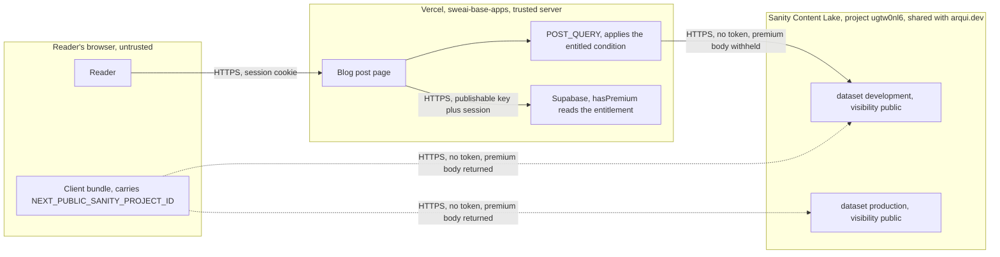

# ADR-NNN: Gate the first premium post on a private Sanity dataset

**Date:** 2026-11-21
**Status:** Proposed
**Related ADRs:** [ADR-005](ADR-005-paywall-enforced-in-the-groq-query.md) decides how the
application resolves a premium body; this record decides the boundary below it and does not
supersede it. [ADR-006](ADR-006-hosted-sanity-studio.md) puts the Studio on the same Sanity
project. [ADR-002](ADR-002-rls-as-the-authorization-layer.md) is the authorization layer that
Option C would reuse.

---

## Context

Both Sanity datasets on project `ugtw0nl6` are public: `npx sanity datasets visibility get
development` and the same command for `production` each returned `public` on 2026-11-21, and an
anonymous GROQ request to `production` returned five documents. `NEXT_PUBLIC_SANITY_PROJECT_ID`
is inlined into the client bundle by `src/env.public.ts:85`, so the project id is not a secret,
and `src/lib/sanity.ts:12` builds the only content client with no token. The `$entitled`
condition in `POST_QUERY` at `src/features/posts/posts.queries.ts:28` therefore controls what
this application returns and nothing about what the Content Lake returns to a request the
application never made: `*[_type=="post"]{isPremium, body}` sent anonymously would return every
published premium body. Exposure is zero today because neither dataset holds a `post` document,
and it becomes real with the first published premium post, so the decision is needed before that
post exists rather than after.

## Decision drivers

- Quality goal one is that paid content stays paid. A paywall that a single anonymous HTTP
  request defeats is a product gate, not a confidentiality control, and the architecture
  documentation must say which of the two it is.
- Zero `post` documents exist in either dataset, measured 2026-11-21, so nothing is exposed now
  and no remediation is urgent.
- Private datasets start on the Sanity Growth plan at $15 per seat per month, and a downgrade to
  the Free plan converts a private dataset back to public. The control is a billing state, not a
  configuration flag.
- Project `ugtw0nl6` is named `arqui.dev`, carries two members, and holds five `offerList`
  documents for which this repository has no schema: `sanity/schema/` declares only `post`.
  Changing that project's plan or dataset visibility is a change to another property's
  infrastructure, not a change local to Hire Service.
- `SANITY_API_READ_TOKEN` is already declared at `src/env.ts:49` and already documented at
  `.env.example:35`, and nothing in the repository reads it. The contract for the fix exists and
  is unwired.
- CLAUDE.md states that this repository does not own content storage, which prices any option
  that moves premium bodies out of the CMS.

## Options considered

### Option A: Private dataset plus a server-side read token (chosen as the endpoint)

Set the dataset's visibility to private and pass `SANITY_API_READ_TOKEN` to the client in
`src/lib/sanity.ts`. The Content Lake refuses anonymous reads, and the application reads with a
token that never leaves the server.

**Pros:** The control sits at the boundary an attacker actually crosses. Editors keep writing in
Studio, the content model does not change, and `@sanity/client` 8.14.1 caches authenticated
requests on the API CDN with the cache segmented per token, so `useCdn: true` stays correct.
**Cons:** Requires the Growth plan on a Sanity project this repository does not own, which is
$30 a month at the project's current two seats. The control reverts silently on a downgrade to
Free. A private dataset answers an unauthenticated read with HTTP 200 and an empty result rather
than an error, so a missing or placeholder token produces a blank blog instead of a failure.

### Option B: A second, private dataset holding only premium bodies

Free posts stay in the public dataset, premium bodies move to a private one, and the application
reads from both.

**Pros:** Public content stays on the uncached-by-nothing public path, and the blast radius of a
leaked read token is one dataset.
**Cons:** Needs the same Growth plan as Option A, so it buys no cost saving. Splits one post
across two datasets, which splits the editor workflow and gives Studio two places to look for
one document. Two clients to configure instead of one.

### Option C: Premium bodies in Postgres behind row level security

Sanity keeps title, slug, excerpt, cover image, tags and `isPremium`. The premium body moves to a
table in `supabase/schema.sql` and is read through the authorization layer ADR-002 already
established.

**Pros:** No plan change and no incremental cost, because Supabase is already in the stack. The
control survives any Sanity billing change. The gate becomes plain SQL policy, testable the way
other policies are.
**Cons:** Editors lose Studio for the one field that matters most, and this repository has no
admin UI, so premium bodies would be written as Portable Text into Postgres by hand. It
contradicts the stated ownership boundary that content storage is not this repository's. It makes
one post two rows in two stores with no transaction across them.

### Option D: Accept the public dataset and record the limit (chosen for now)

Leave both datasets public, state in the architecture documentation that the paywall is a product
gate rather than a confidentiality control, and name the first premium post as the trigger that
activates Option A.

**Pros:** Costs nothing, changes no shared infrastructure, and is the only option whose required
work is already complete the moment the documentation is correct. It is also the only honest
description of the system as it runs today.
**Cons:** The paywall is defeated by one anonymous request the moment a premium post is
published, and the trigger is enforced by a document rather than by a check. Nothing in CI or at
runtime fails if someone publishes a premium post while the dataset is public.

## Comparison

| Criterion | A: private dataset | B: split datasets | C: bodies in Postgres | D: accept the limit |
|-----------|--------------------|-------------------|-----------------------|---------------------|
| Premium body readable by an anonymous GROQ query | no | no | no | yes |
| Monthly plan cost at the project's two seats | $30 | $30 | $0 | $0 |
| Editors write premium bodies in Studio | yes | yes | no | yes |
| Source files this repository changes | 2 | 4 | 6 or more, including `supabase/schema.sql` | 0 |
| Control survives a downgrade to the Sanity Free plan | no | no | yes | not applicable |
| Requires a plan or visibility change on a project owned by `arqui.dev` | yes | yes | no | no |

## Recommendation

Option D now, with Option A as the committed successor at a named trigger. The deciding criterion
is exposure: zero `post` documents exist in either dataset, so the only thing currently at risk
is a claim in `docs/arc42/11-risks-and-technical-debt.md` that a mitigation exists where none
does, and correcting that claim is free. Option A is the right endpoint and the wrong thing to
buy today, because it spends $30 a month and changes the plan and dataset visibility of a Sanity
project that serves another property, in order to protect content that does not exist.

Option A activates when the first post with `isPremium` set to true is published, or when any
content in project `ugtw0nl6` becomes commercially sensitive, whichever comes first. Option C
becomes correct instead if the project must stay on the Sanity Free plan permanently, because
only Option C holds without a paid plan. Option B does not become correct at any price point
reachable from here: it costs what Option A costs and buys a split editor workflow.

**[NEEDS INPUT]:** Is project `ugtw0nl6` on the Sanity Free plan today, which is what
`sanity.io/manage` shows and the CLI does not?

**[NEEDS INPUT]:** Is `NEXT_PUBLIC_SANITY_DATASET` set to `development` or `production` in the
Vercel production environment, given that `.env.local:18` says `development` and
`docs/arc42/07-deployment-view.md:71` says `production` for every environment?

## Consequences

**Good:**

- The architecture documentation stops claiming a mitigation that does not exist. The row in
  `docs/arc42/11-risks-and-technical-debt.md:32` names the real impact and the real absence of a
  control, so the next reviewer does not have to rediscover it.
- ADR-005 keeps its decision and gains the boundary it was missing. Its decision driver already
  said the dataset is public-read and that the query must not be the only secret; this record is
  where that observation finally has a control attached and a date.
- `SANITY_API_READ_TOKEN` stops being dead configuration that looks live. It is now the declared
  hook for Option A, with a recorded activation trigger instead of no reader and no reason.
- The coupling between Hire Service and the `arqui.dev` Sanity project is written down.
  `docs/arc42/07-deployment-view.md:60` states that `arqui.dev` is a different repository and a
  different Vercel project, which is true and which readers have been generalizing to Sanity.

**Bad:**

- Between now and the trigger, a premium post published by anyone with Studio access is
  readable by anyone with the project id. The enforcement is a sentence in a document, and this
  record does not change that.
- The trigger depends on a human noticing it. No CI check and no runtime assertion fires when a
  premium post meets a public dataset, and `assertNoLeak` does not help: it guards the
  application's own response, which is already correct.
- Option A's eventual migration crosses into another property's Sanity project unless Hire
  Service gets its own project first, which is additional work this record defers rather than
  removes.

**Action items:**

- [ ] Replace the risk row at `docs/arc42/11-risks-and-technical-debt.md:32` with the corrected
      impact and the empty mitigation. The replacement text is in the run artifact at
      `docs/runs/2026-11-21-full-review/02-sanity-dataset-paywall-cloud-solutions-architect.md`.
- [ ] Add a risk row recording that project `ugtw0nl6` is shared with `arqui.dev` and that a plan
      or visibility change there is not a Hire Service local change.
- [ ] Correct the Sanity dataset column in `docs/arc42/07-deployment-view.md:71` to match the
      value each environment actually uses, once the Vercel value is confirmed.
- [ ] Change `.env.example:35` so it stops instructing the operator to provision a token that no
      code path reads. Keep the variable documented as the Option A hook, commented out.
- [ ] When Option A activates, add `SANITY_API_READ_TOKEN` to the `configured` map in
      `src/shared/config-check.ts`. Without it, a placeholder token against a private dataset
      renders an empty blog and reports nothing, which is the exact failure mode CLAUDE.md warns
      about for an unmapped credential.
- [ ] At merge, assign the number, rename the file, add the row to
      `docs/arc42/09-architecture-decisions.md`, and add the reciprocal link to ADR-005's
      Related ADRs line. The MADR rule is that related links are bidirectional, and the back-link
      cannot be written before the number exists.
- [ ] When Option A activates, order the rollout so the token ships before the visibility
      changes. A read token against a public dataset is harmless, while a private dataset with no
      token answers every read with HTTP 200 and an empty result and the blog degrades silently.

## Diagram

The question this diagram answers: which requests the `$entitled` condition governs, and which
it does not.

The solid path from the page is the one ADR-005 governs. The dashed paths are the same datasets
reached without the application, and no decision recorded before this one covers them.

## Sources

- [Sanity datasets: public and private visibility, and the CLI command to read and set
  it](https://www.sanity.io/docs/content-lake/datasets)
- [Sanity, keeping your data safe: an unauthenticated request to a public dataset can only read
  documents whose `_id` contains no dot](https://www.sanity.io/docs/content-lake/keeping-your-data-safe)
- [Sanity API CDN: authenticated requests are cached, segmented per
  token](https://www.sanity.io/docs/content-lake/api-cdn)
- [Sanity pricing: Free offers two public-only datasets, Growth is $15 per seat per month and
  adds private datasets](https://www.sanity.io/pricing)
- [Sanity mutation API reference: all requests must be
  authenticated](https://www.sanity.io/docs/http-reference/mutation)
