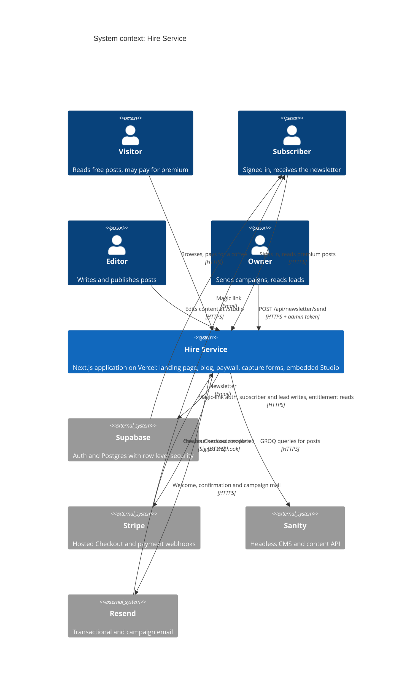

# 3. Context and scope

## C4 level 1: system context

## In scope

Reading free and premium posts, one-off payment for premium access, magic-link
sign in, a profile page showing access and subscription state, newsletter
subscribe, signed unsubscribe and campaign send, two lead lists, a
single-line-item cart, five themes, and the embedded Sanity Studio.

## Out of scope

Recurring subscriptions, refunds, invoicing, multi-currency, team accounts,
comments, search, i18n, and an admin UI. Section 11 records which of these are
likely next and what triggers each.

## External interfaces

| Direction | Interface | Contract |
|-----------|-----------|----------|
| In | `POST /api/newsletter` | `{ email, name?, source? }`, validated by `subscribeInput` |
| In | `POST /api/leads` | `{ email, list, name?, company?, note? }`, validated by `leadInput` |
| In | `POST /api/checkout` | `{ quantity?, email?, slug? }`, validated by `checkoutInput`; price comes from server config |
| In | `POST /api/stripe/webhook` | Stripe event, rejected unless the signature verifies |
| In | `POST /api/newsletter/unsubscribe` | `?e=<email>&t=<hmac>`, POST only, signature verified in constant time |
| In | `POST /api/newsletter/send` | `{ subject, html, limit? }`, bearer `ADMIN_API_TOKEN`, compared in constant time |
| In | `GET /auth/callback` | Supabase magic-link code, redirects to a same-origin path only |
| Out | Supabase REST and Auth | `@supabase/ssr` and `@supabase/supabase-js` |
| Out | Sanity content API | GROQ over `next-sanity`, 60 second revalidate |
| Out | Stripe API | Checkout Sessions, API version pinned in `src/lib/stripe.ts` |
| Out | Resend API | `emails.send` and `batch.send`, up to 100 per batch |
