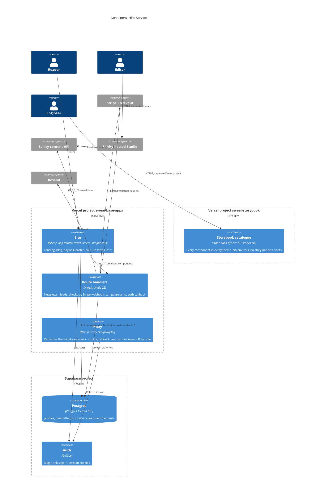
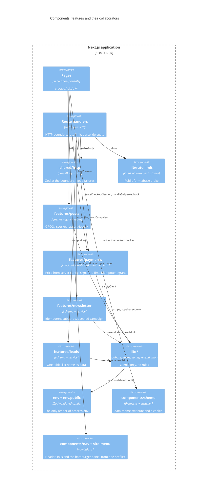

# 5. Building block view

## C4 level 2: containers

## C4 level 3: components inside the application

## Navigation

`src/components/nav-links.ts` holds every navigable page. `PRIMARY_LINKS` is
the subset shown inline in the header above the `sm` breakpoint; `NAV_GROUPS`
is the full list, grouped Read, Support and Join, rendered by
`src/components/site-menu.tsx` at every screen size. Both arrays carry
`as const`, so `typedRoutes` checks each `href` against the generated route
union and a renamed page fails the typecheck instead of shipping a dead link.

`/success`, `/unsubscribe`, `/auth/*` and `/api/*` are absent on purpose:
arriving at one by clicking makes no sense.

`site-menu.tsx` uses the Popover API, so it holds no state and is not a client
component. The browser supplies light dismiss, top-layer stacking and
`aria-expanded` on the invoker. Section 11 records the ceiling.

## Component catalogue

Every component has a story under `src/**/*.stories.tsx`, and the stories are
not decorative. The `storybook` project in `vitest.config.mts` runs each one as
a Chromium browser test under `npm run test`, with `@storybook/addon-a11y` set
to `error`. A component that stops rendering, or grows an accessibility
violation, fails the build. `.storybook/preview.tsx` puts `data-theme` on the
story wrapper, so the toolbar re-skins every story without touching a prop. The
catalogue itself deploys as the second Vercel project in section 7.

## Responsibilities

| Building block | Owns | Must not |
|----------------|------|----------|
| `src/app/(site)/**` | Layout, copy, which component renders, plus `not-found`, `error` and `loading` | Call Stripe, Supabase or Sanity directly |
| `src/app/robots.ts`, `src/app/sitemap.ts` | What crawlers may index | Fail the response when Sanity is down |
| `src/app/api/**` | Rate limiting, parsing, status codes | Hold business rules |
| `src/features/posts` | The read rule for premium content | Know about HTTP |
| `src/features/payments` | Price, grant, idempotency, signature check | Trust any number from a request |
| `src/features/newsletter` | Subscribe idempotency, batch size | Fail a subscribe because mail failed |
| `src/features/leads` | List membership and position | Need a migration for a new list |
| `src/components/**` | Markup and theme tokens, one story per component | Hold a colour literal or a per-theme branch |
| `src/components/nav-links.ts` | The only list of navigable hrefs | Carry a route that is not a page |
| `src/lib/**` | One configured client each | Contain an `if` about business state |
| `src/env.ts` | Reading `process.env` | Be imported by a client component |
| `src/shared/**` | `Result`, logging, body parsing | Import from `features` |
