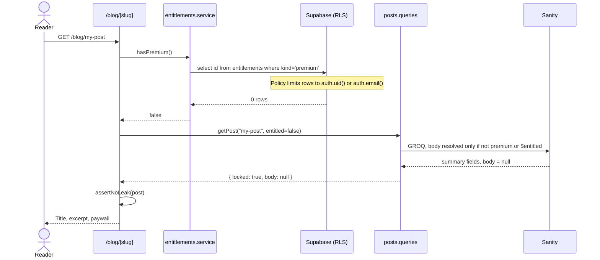
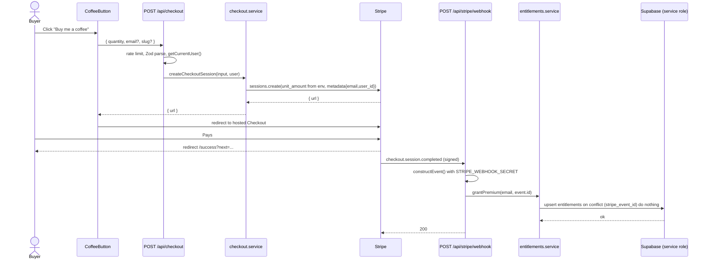
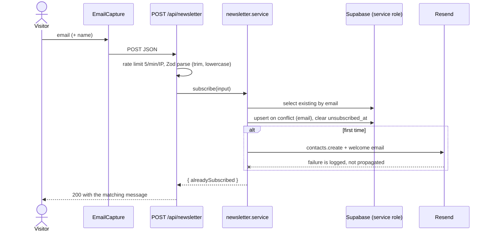
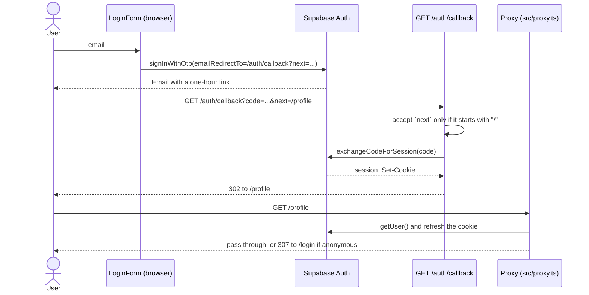

# 6. Runtime view

Four flows. They were chosen because each one is where a mistake costs
something real: money, access, or a mailing list.

## 6.1 Reading a premium post

The gate is the GROQ query, not the component. For a locked post the body is
never resolved, so it never enters this process.

## 6.2 Buying a coffee

Price and currency come from `src/env.ts`. The request only carries a quantity,
and the quantity is clamped to 1 to 20 by Zod.

Failure handling that matters:

| Failure | Response | Why |
|---------|----------|-----|
| Signature missing or wrong | 400 | Stripe stops retrying, and nothing is granted |
| Grant write fails | 500 | Stripe retries, and the unique `stripe_event_id` makes the retry safe |
| Event replayed | 200, no second row | `on conflict do nothing` |
| Paid but not signed in | Granted to the receipt email | The read policy matches on `auth.email()` later |

## 6.3 Subscribing to the newsletter

The address is stored first. Mail delivery is best effort, because a Resend
outage must not show the visitor a failed subscribe.

## 6.4 Magic-link sign in

Open-redirect protection lives in two places on purpose: `/auth/callback`
rejects any `next` that is not a same-origin path, and `/success` does the same
with its own `next`.
