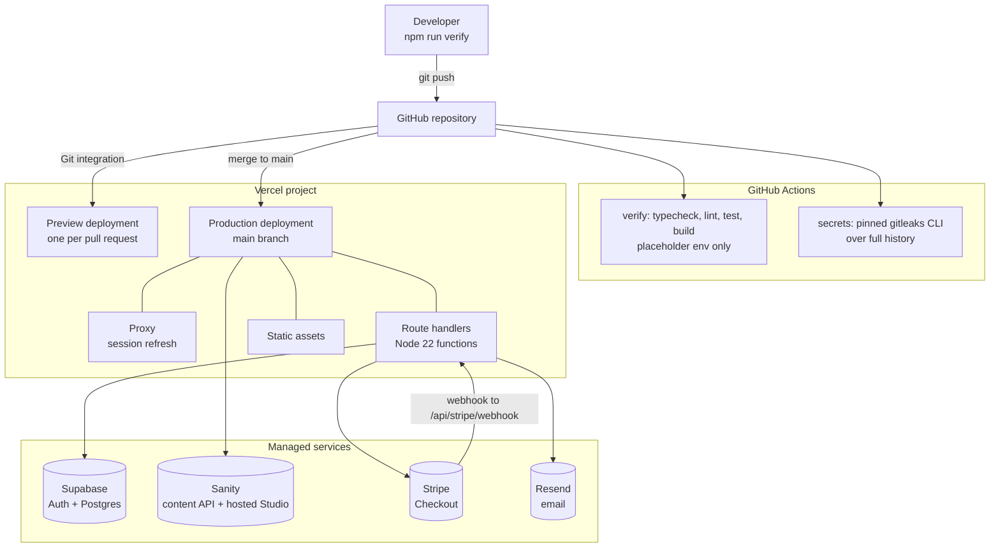

# 7. Deployment view



## Environments

| Environment | URL | Supabase | Sanity dataset | Stripe |
|-------------|-----|----------|----------------|--------|
| Local | `localhost:3000` | Dev project | `production` | Test keys, `stripe listen` forwards the webhook |
| Preview | Vercel per-branch URL | Dev project | `production` | Test keys |
| Production | Custom domain | Prod project | `production` | Live keys |

Previews share the dev Supabase project on purpose: a per-branch database is
not worth the setup for a study base. The cost is that one bad preview can dirty
dev data, which is recorded in section 11.

## Environment variables

Every variable may be created empty. The deployment boots and renders, and each
feature degrades until its key is filled in, so a project can be created and
wired before any account exists. Empty secrets get random bytes at boot rather
than the committed placeholders, so an unconfigured deployment rejects every
admin token, webhook signature and unsubscribe link instead of accepting a
value published in this repository.

Set every key from `.env.example` in the Vercel project. Two rules:

- `SUPABASE_SECRET_KEY`, `STRIPE_SECRET_KEY`, `STRIPE_WEBHOOK_SECRET`,
  `RESEND_API_KEY`, `ADMIN_API_TOKEN` and `NEWSLETTER_SECRET` are server-only. A
  `NEXT_PUBLIC_` prefix on any of them publishes it to every browser.
- `NEWSLETTER_SECRET` signs unsubscribe links. Rotating it breaks every link in
  an inbox, so generate it once per environment with
  `openssl rand -base64 32` and leave it alone.
- `NEXT_PUBLIC_SITE_URL` must match the deployment it runs on, because Stripe
  redirect URLs and magic-link callbacks are built from it. Left empty it falls
  back to `NEXT_PUBLIC_VERCEL_URL`, which is right for a preview and wrong for
  production on a custom domain.

## Deploy steps for a fresh copy

```bash
# 1. Database
#    Paste supabase/schema.sql into the Supabase SQL editor, or:
supabase db push

# 2. Content
npx sanity dataset create production   # once per project
npx sanity deploy                      # publishes the Studio, prints its URL
#    Put that URL in NEXT_PUBLIC_SANITY_STUDIO_URL, then create a post.
#    Re-run `sanity deploy` after any change to sanity/schema/.

# 3. Payments: point a Stripe webhook at the deployment
stripe listen --forward-to localhost:3000/api/stripe/webhook   # local
#    Production: add the endpoint in the Stripe dashboard and copy the
#    signing secret into STRIPE_WEBHOOK_SECRET.

# 4. Auth: in Supabase, add these to the allowed redirect URLs
#    https://<domain>/auth/callback
#    https://<branch>.vercel.app/auth/callback

# 5. Ship
vercel link && vercel --prod
```

## Sending a campaign

```bash
curl -X POST https://<domain>/api/newsletter/send \
  -H "authorization: Bearer $ADMIN_API_TOKEN" \
  -H "content-type: application/json" \
  -d '{"subject":"New post: the paywall is a GROQ query","html":"<p>...</p>","limit":100}'
```

`limit` caps one invocation at 500 addresses. The endpoint has no scheduler
behind it, which is deliberate: see section 11.
