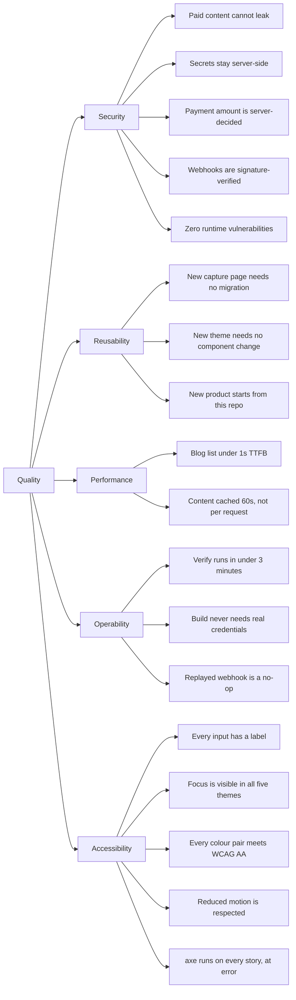

# 10. Quality requirements

## Quality tree

## Scenarios

| # | Scenario | Response | Measured by |
|---|----------|----------|-------------|
| S1 | A reader without an entitlement requests a premium post | The body is not in the HTTP response, and not in the Node process | `posts.gate.test.ts`, plus `assertNoLeak` at runtime |
| S2 | A client posts `{"quantity":2,"unitAmount":1}` | Charged two coffees at the server price; `unitAmount` is stripped | `payments.schema.test.ts` |
| S3 | Stripe replays `checkout.session.completed` | One entitlement row, 200 response | `unique (stripe_event_id)` plus `ignoreDuplicates` |
| S4 | A forged webhook arrives with no signature | 400, nothing written | `handleStripeWebhook` returns `BAD_SIGNATURE` before reading the body |
| S5 | Resend is down when someone subscribes | 200, address stored, failure logged | `subscribe()` catches and logs the send |
| S6 | A sixth theme is needed | One CSS block and one array entry, no component diff | `themes.css` plus `THEMES` |
| S7 | A third capture list is needed | One enum value, no migration | `LEAD_LISTS` plus the `check` constraint |
| S8 | A contributor runs `npm run verify` on a clean clone | Typecheck, lint and tests pass with placeholder env | CI job `verify` |
| S9 | A secret is committed | The pipeline fails before merge | CI job `secrets` with gitleaks |
| S10 | A mail security scanner prefetches an unsubscribe link | Nothing changes; the endpoint rejects GET | `POST` only handler, confirm button on the page |
| S11 | Someone posts an unsubscribe for a guessed address with no token | 403, nothing written | `unsubscribe.test.ts` |
| S12 | Sanity is unreachable when a crawler requests the sitemap | 200 with the static paths, warning logged | `try`/`catch` in `src/app/sitemap.ts` |
| S13 | `assertNoLeak` throws on a post render | The error boundary renders, never a partial post | `src/app/(site)/error.tsx` |
| S14 | A theme is edited and a colour pair drops below AA | The test suite fails before the build | `themes.contrast.test.ts`, 45 measured pairs over five themes |
| S15 | A dependency with a known advisory is added | `npm audit --omit=dev --audit-level=info` fails the build | CI job `dependencies` |
| S16 | An editor stores a `javascript:` link in a post | The href renders as `#` | `sanitize.test.ts`, seven hostile schemes |
| S17 | Someone submits a name containing markup and a victim's address | The victim receives escaped text, not working markup | `sanitize.test.ts` |
| S18 | A keyboard user tabs the cart | Focus ring visible in all five themes | `:focus-visible` rule in `globals.css` |
| S19 | A component stops rendering, or grows an accessibility violation | `npm run test` fails before the build | Every story in `src/**/*.stories.tsx` as a Chromium test in the `storybook` project of `vitest.config.mts`, `@storybook/addon-a11y` at `error` |
| S20 | A page is renamed and a header or menu link is left behind | The typecheck fails | `typedRoutes` against the `as const` arrays in `src/components/nav-links.ts` |

`npm run test` runs both projects in `vitest.config.mts`: the node unit tests
and every story as a browser test. CI installs Chromium before running it. The
suite count moves with every commit, so it is not written down here; run
`npx vitest list` for the current figure.

## What is not measured

No load testing, no Lighthouse budget in CI, no error-rate alerting, and no
uptime monitor. For a study base the cost outweighs the signal. Section 11
records the trigger for each.

Accessibility coverage stops at what axe can see in an isolated story. Focus
order through a whole flow, landmark structure across a page, and the keyboard
path from the header into the hamburger panel are still hand-checked, which is
item A5 in [the roadmap](../ai-roadmap.md).
