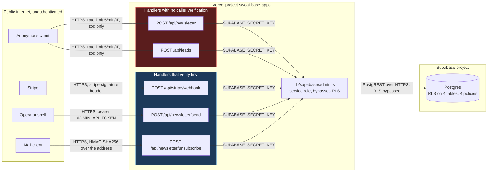

# 01: The documented architecture against the code

**Agent:** `cloud-solutions-architect`
**Prompt:** `docs/prompts/01-architecture-vs-code.md`
**Date:** 2026-11-21
**Linear:** UNTRACKED

## Verdict

`docs/arc42/` and the eight ADRs describe the system that exists at `bd42a3d`
in shape and miss it in five load-bearing details. The topology is accurate:
the container boundaries, the proxy, the paywall path, the schema tables, the
CI jobs and the two Vercel projects all match the code. The failures are in the
claims that a future change would be checked against.

Three things decide the verdict.

**ADR-006's reversal condition has been met, and acting on it would re-create
the problem it solved.** `next-sanity@13.5.1` now lists `sanity` under
`peerDependencies`, which is the literal trigger ADR-006 wrote down. Measured,
the trigger is wrong: npm installs non-optional peers, so an embedded Studio
puts `sanity` and `styled-components` back into the production tree, 803
packages and 16 advisories deep. The condition named a manifest field when it
meant a measured outcome.

**The service-role key reaches Supabase from two unauthenticated entry points.**
Five documents and the code's own doc comment say two verified call sites. There
are four importing modules, and `POST /api/newsletter` and `POST /api/leads`
reach two of them with nothing but a rate limit and a Zod schema in front.

**ADR-007's non-negotiable gate was failing at the reviewed commit.**
`npm run audit:runtime` exits 1 at `bd42a3d`. The quality goal in section 10,
the product brief's success table and section 11 all assert zero runtime
vulnerabilities. A sibling agent has already fixed it in the working tree.

None of the eight decisions is wrong. Two need a corrected record, one needs a
re-decision, and the count errors need a pass.

## Ref record

Measured at dispatch and again at completion. Every repository read is listed,
including the one the brief named only as a conventions source.

| Repository | Branch | HEAD | vs `origin/main` | Dirty at dispatch | Dirty at completion |
|---|---|---|---|---|---|
| `hire-service` | `main` | `bd42a3d` | 0 behind, 0 ahead | 2 | 8 |
| `ai-software-engineering` | `feat/devops-agent-team` | `7cbfc13` | 0 behind, 11 ahead | 4 | 4 |

**HEAD moved during this run.** `bd42a3d` is the commit the prompt names and
the commit every finding below was measured against. By completion `HEAD` was
`41c4136`, three commits ahead, all written by sibling agents in this run:

```text
41c4136 docs: add the engagement contract the agent team reads
c4fb824 fix: log when the resend audience is unconfigured
7f60bf9 fix: bump next to 16.4.6 for seven advisories
bd42a3d (reviewed)
```

`git diff --stat bd42a3d..41c4136` touches four files: `CLAUDE.md`,
`package.json`, `package-lock.json` and
`src/features/newsletter/newsletter.service.ts`. Every finding below was
re-checked against `41c4136`. One is resolved there (F2). One moved by two line
numbers and both are given. The other eleven are unchanged.

`ai-software-engineering` matches the Stage 0 record exactly: four untracked
paths, all of them `.DS_Store`, `docs/article-index.md` and `docs/articles/`.

`hire-service` does not. The Stage 0 record says 0 dirty files. Measured at
dispatch:

```text
 M CLAUDE.md
?? docs/prompts/
```

The `CLAUDE.md` modification is 74 inserted lines adding the sections this run
reads as fact source 2: environments and promotion order, ticket conventions,
verification commands, documentation locations and the agent team table. It is
this run's own setup, not drift, and it is uncommitted. Fact source 2 is
therefore an uncommitted working-tree file.

By completion, sibling agents in the same run had also modified `package.json`,
`package-lock.json` and `src/features/newsletter/newsletter.service.ts`, and
added `docs/adr/ADR-NNN-private-sanity-dataset-as-the-premium-content-gate.md`,
and later `.github/workflows/ci.yml`. The relevant ones are `package.json`,
covered in F2, and the workflow, covered in F2b.

## Framework lens

Vercel's own **Production checklist for launch**, last updated 2026-08-11,
resolved first-party in this session from
`https://vercel.com/docs/production-checklist`. Its five section names are
Operational excellence, Security, Reliability, Performance efficiency and Cost
optimization. Those are Vercel's section names on Vercel's own page. They are
not AWS pillar names and carry none of the AWS pillar content.

The second lens is the **Next.js production checklist**, last updated
2026-11-06, from `https://nextjs.org/docs/app/guides/production-checklist`,
applied to the application layer.

No AWS, Google Cloud, Azure or Kubernetes lens applies. There is no cluster, no
Terraform and no Helm in this repository, and the four data stores are managed
SaaS the repository does not own.

Each finding below carries exactly one Vercel section as its pillar.

## What exists, measured

Every claim in this section cites a file and line or a command and its output.
Nothing here is inferred from a file name.

| Element | Measured | Evidence |
|---|---|---|
| Route handlers | 8 | `src/app/api/{checkout,leads,newsletter,newsletter/send,newsletter/unsubscribe,stripe/webhook}/route.ts`, `src/app/auth/{callback,signout}/route.ts` |
| Source files under `src/` | 92 `.ts`, `.tsx`, `.css` | `find src -type f \( -name '*.ts' -o -name '*.tsx' -o -name '*.css' \) \| wc -l` |
| Client components | 9 | `grep -rln '"use client"' src/` |
| Stories | 8 | `find src -name '*.stories.tsx'` |
| RLS policies | 4 | `grep -c "^create policy" supabase/schema.sql` |
| Tables with RLS enabled | 4 | `grep -c "enable row level security" supabase/schema.sql` |
| Theme blocks | 5, 16 tokens each | `src/app/themes.css:19,38,57,76,95` |
| Contrast pairs tested | 45 (7 text + 2 boundary, over 5 themes) | `src/app/themes.contrast.test.ts:53,63,79` |
| Production packages | 78 top-level named | `npm ci --omit=dev` in a clean directory, then counting directories holding a `package.json` with a `name` |
| `npm run audit:runtime` at `bd42a3d` | exit 1, 1 moderate | see F2 |
| `npm audit` full tree | 31 total, 28 moderate, 3 high | `npm audit --json`, `metadata.vulnerabilities` |
| Modules importing `supabaseAdmin` | 4 non-test | see F1 |
| Vercel project config in repo | none | `ls vercel.json` returns no such file |
| Scheduler or cron | none | no `vercel.json`, no `schedule:` in `.github/workflows/` |

Separately, and labeled as such: the production Node runtime, the Vercel
project names `sweai-base-apps` and `sweai-storybook`, the Supabase Postgres
major version and the Sanity dataset visibility are **not measured**. They live
in provider dashboards this run is read-only against and unauthenticated for.
Section 5 states "Postgres 15" and sections 5 and 7 state "Node 22". The Node
claim matched `package.json` `engines.node >= 22.0.0` and
`.github/workflows/ci.yml:44,77` pinning `node-version: 22` at dispatch, and a
sibling agent changed both to 26 during this run (F2b). Either way those
constrain CI and not the Vercel runtime.

## Findings, worst first

### F1. The service-role key reaches Supabase from two unauthenticated endpoints

**Pillar:** Security. **Severity:** High.

Five places assert two verified call sites:

| Where | Text |
|---|---|
| `src/lib/supabase/admin.ts:6-9` | "only reachable from route handlers that have already authenticated the caller: the Stripe webhook (signature-verified) and the newsletter sender (admin token)" |
| `docs/adr/ADR-002-rls-as-the-authorization-layer.md:82-84` | "imported by exactly two paths: the signature-verified Stripe webhook and the token-verified campaign sender" |
| `docs/arc42/08-crosscutting-concepts.md:27-29` | "The service-role key appears in exactly two call paths" |
| `docs/arc42/12-glossary.md` | "Used in two signature or token verified paths only" |
| `.claude/agents/security-reviewer.md:46` | Invariant 3, "Two call sites today" |

Measured, `rg -n 'supabaseAdmin' src/` returns four non-test importing modules:

| Module | Line | Reached from | Caller verification before the admin client runs |
|---|---|---|---|
| `src/features/payments/entitlements.service.ts` | 1, 19 | `POST /api/stripe/webhook` | Stripe signature, `webhook.service.ts:23` |
| `src/features/newsletter/newsletter.service.ts` | 3, 28, 47, 121 (123 at `41c4136`) | `POST /api/newsletter` and `POST /api/newsletter/send` | admin token on `send` only. None on subscribe |
| `src/features/leads/leads.service.ts` | 2, 12, 28 | `POST /api/leads` | none |
| `src/features/newsletter/unsubscribe.ts` | 4, 45 | `POST /api/newsletter/unsubscribe` | HMAC over the address |

The two anonymous paths are traced end to end. `src/app/api/newsletter/route.ts:26`
calls `subscribe()`, which reads `newsletter_subscribers` at
`newsletter.service.ts:28` and writes it at line 47, both through
`supabaseAdmin`. `src/app/api/leads/route.ts` calls `captureLead()`, which
upserts `leads` at `leads.service.ts:12` and runs a table-wide
`count: "exact"` at line 28, both through `supabaseAdmin`. Neither handler
authenticates the caller. `src/app/api/newsletter/route.ts:23` reads the
session, but only to decide `allowResubscribe`, not to gate the admin client.

This is not a new vulnerability and this review does not claim one. The schema
is the reason: `newsletter_subscribers` and `leads` have no insert policy
(`supabase/schema.sql:74-84,100-102`), so the service role is the only way to
write them, which is a deliberate consequence of ADR-002. The finding is that
the invariant as written is false, and it is the invariant the
`security-reviewer` agent, `CLAUDE.md` and ADR-002 all check future changes
against. An invariant that is already false cannot catch the change that
breaks it.



**What to change.** The documentation, not the code. The correct statement is
four modules and two trust levels: signature or token verified for the webhook
and the campaign sender, and rate limit plus schema validation only for
newsletter subscribe and lead capture, which have no policy path available to
them. Fix all five locations in one commit, or the next reviewer will re-derive
this.

### F2. `npm run audit:runtime` exits 1 at the reviewed commit

**Pillar:** Operational excellence. **Severity:** High at `bd42a3d`, resolved
at `41c4136` by `7f60bf9`, "fix: bump next to 16.4.6 for seven advisories".

```bash
$ npm run audit:runtime     # at package.json next=16.4.3
EXIT=1
# next 16.0.0 - 16.4.4, severity moderate, 7 advisories
# 1 moderate severity vulnerability
```

`npm audit --omit=dev --json` reports `metadata.vulnerabilities.moderate: 1`,
`total: 1`, against `next`, which is `isDirect: true`. The seven advisories are
GHSA-mfr8-8qww-v76h, GHSA-vc7v-qv4w-wrv8, GHSA-7qx7-33qx-rqx2,
GHSA-f3mh-rxg3-f5g2, GHSA-pc58-hwjq-p385, GHSA-rhh4-g77r-r9qj and
GHSA-vvgp-ww4w-46vf.

Four records assert the opposite:

| Where | Claim |
|---|---|
| `CLAUDE.md`, security policy | "Never accept a runtime vulnerability ... any advisory at all in the `--omit=dev` tree fails the build" |
| `docs/adr/ADR-007-...md`, policy section 1 | the gate, with no triage step and no accepted-risk list |
| `docs/arc42/10-quality-requirements.md`, S5 and S15 | "Zero runtime vulnerabilities", CI job `dependencies` fails the build |
| `docs/product/product-brief.md`, success table | "Runtime vulnerabilities, Today 0, Target 0" |

The `dependencies` job in `.github/workflows/ci.yml:84-85` was therefore red at
`bd42a3d`. Section 11's build-time row also needs correcting: it says "the 32
findings" with roots "`js-yaml`, `smol-toml`, `undici`, `glob` and `minimatch`,
none of which exists in the 78-package production install". Measured today the
full tree reports 31 findings across 31 advisory roots, and `next` is one of
them and is in the production install.

A sibling agent has since committed the fix as `7f60bf9`:

```diff
-    "next": "16.4.3",
+    "next": "^16.4.6",
-    "eslint-config-next": "16.4.3",
+    "eslint-config-next": "^16.4.6",
```

Re-measured at `41c4136`, `npm run audit:runtime` exits 0 with "found 0
vulnerabilities". That remediation belongs to prompt 03 and this review does not
claim it. Two notes for whoever reviews that diff. First, moving the framework
from an exact pin to a caret range changes whether a Next minor can reach
production without a commit, and nothing records that; ADR-007 forbids `latest`
but states no exact-pin rule, so this is a gap rather than a violation. Second,
`npm audit --omit=dev` passing is a point-in-time measurement against a public
advisory feed, so a gate written as "zero, always" will fail on a day nobody
touched the repository. ADR-007 has no statement about what happens on that day,
and that absence is the reason this finding reads as a surprise rather than as a
Tuesday.

### F2b. A documented constraint changed during this run, without this role

**Pillar:** Operational excellence. **Severity:** Medium. Numbered `F2b` because
it appeared in the working tree after the findings below were numbered.

`docs/arc42/02-constraints.md` opens with "These were fixed before any code
existed. They are not decisions, and the ADRs in section 9 do not revisit
them." Its first technical row:

| Constraint | Consequence |
|---|---|
| Node 22 LTS | `engines.node >= 22`, and CI pins the same major |

Both halves of that cell are now false in the working tree. Measured:

```diff
# .github/workflows/ci.yml, both the verify and dependencies jobs
-          node-version: 22
+          node-version: 26
```

```json
// package.json
"engines": { "node": "26.x" }
```

`docs/arc42/05-building-block-view.md:15` and
`docs/arc42/07-deployment-view.md:21` still read "Node 22".

The version choice is defensible. Node.js v26 "Lithium" first released
2026-05-05 and carries status LTS as of 2026-11-10, per
`https://nodejs.org/en/about/previous-releases`, and v22 "Jod" is still LTS on
the same table. Either satisfies `docs/product/product-brief.md`'s "Node LTS".
No support-horizon objection is raised here.

The process is the finding. Changing the runtime major is a change to a stated
technical constraint, and this role's definition makes it the only role that
may change one. It arrived through prompt 03's diff with no ADR, no amendment
to section 2, and the diagrams left behind. The brief assigns "Node 26 in
production" to prompt 03, which covers reconciling the deployed runtime with
the repository; it does not cover rewriting the constraint that says 22.

Two things have to land together, and this role proposes both rather than
deciding scope: amend section 2's row and the two diagrams to the chosen major,
and record the change as an ADR with the reason for leaving 22 while 22 is
still LTS. The `sre` reviews that, not this role.

### F3. Section 7 claims a per-environment key split that `env:push` cannot produce

**Pillar:** Security. **Severity:** Medium.

`docs/arc42/07-deployment-view.md` Environments table:

| Environment | Stripe |
|---|---|
| Preview | Test keys |
| Production | Live keys |

`scripts/env-push.sh:40` writes one row across all three targets:

```bash
--production) TARGETS='["production","preview","development"]'; WITH_PROD=1; shift ;;
```

Lines 13 to 18 of the same file say so explicitly, and name the only escape:
"If a key genuinely needs different values per environment, set those in the
dashboard rather than here." `CLAUDE.md` carries the fact under "Environments
and promotion order": one row per secret shared by preview and production, with
the instruction to split the rows before any live credential is set.
`docs/arc42/` carries it nowhere, and no ADR records it.

The consequence is a trust boundary that exists and is undrawn. Every preview
deployment, one per pull request, would read the production Stripe secret key,
the production Supabase service-role key and the production `ADMIN_API_TOKEN`
if those are set through `npm run env:push --production`. Section 11 records
"Previews share the dev Supabase project" and stops there, which reads as the
whole preview exposure and is not.

Vercel's checklist puts Deployment Protection and a Preview Deployment Suffix
in its Security section, and `src/env.public.ts:46-51` already shows the author
has met deployment protection in practice. Neither appears in section 7.

The environment row topology is prompt 04's subject and that agent has already
written
`docs/runs/2026-11-21-full-review/04-env-and-secret-topology-devops-platform-engineer.md`.
This finding is narrower and stays here: section 7 documents a split the
tooling cannot create, and the architecture documentation does not name the
boundary at all.

### F4. Every module that implements a security invariant is absent from the C4 views

**Pillar:** Operational excellence. **Severity:** Medium.

The level 3 component diagram in `docs/arc42/05-building-block-view.md` names
twelve components. The modules that hold the invariants the
`security-reviewer` agent checks are not among them.

| Module | What it owns | In the component view |
|---|---|---|
| `src/shared/safe-url.ts` | `safeHref` scheme allowlist and `safeNextPath` redirect sanitizer, the only expression of invariants 7 and the open-redirect rule | no |
| `src/shared/escape-html.ts` | invariant 6, every value interpolated into outbound mail | no |
| `src/features/newsletter/unsubscribe.ts` | the HMAC trust boundary and its `timingSafeEqual` compare | no |
| `src/shared/config-check.ts` | invariant 9, `setupHint()` returning nothing in production | no |
| `src/shared/logger.ts` | invariant 10, the three mandatory `warn` events | no |

The level 2 container diagram lists the route handlers as "Newsletter, leads,
checkout, Stripe webhook, campaign send, auth callback". Two of the eight are
missing: `POST /api/newsletter/unsubscribe`, which is a distinct trust boundary
with its own credential type, and `POST /auth/signout`. Section 3's external
interfaces table carries the unsubscribe endpoint, so the omission is in the
diagram only.

The component view also draws no edge from `pages` to `libs`, which the code
has, and no edge from `pages` to `features/newsletter`, which
`src/app/(site)/profile/page.tsx:7` has through `unsubscribeUrl`. The
diagram's `Rel(leads, libs, "resend, supabaseAdmin")` and
`Rel(newsletter, libs, ...)` edges are correct and are the only place in the
documentation that implies F1. Nobody read them against the prose.

One diagram answering one question, at container level with the credential on
each edge, would have made F1 visible. The diagram above is that diagram.

### F5. Section 5 and section 4 disagree on whether a page may reach Supabase

**Pillar:** Operational excellence. **Severity:** Medium.

Section 5's Responsibilities table:

| Building block | Must not |
|---|---|
| `src/app/(site)/**` | Call Stripe, Supabase or Sanity directly |

Section 4's Layering section, same documentation set: "A page never calls
Stripe or Supabase directly except through `lib`."

Those are different rules. The code satisfies the second and violates the
first. Measured:

- `src/app/(site)/profile/page.tsx:15-16,23-27` creates a Supabase server
  client and runs `supabase.from("newsletter_subscribers").select(...)` in the
  page body.
- `src/app/(site)/login/login-form.tsx:5` imports the Supabase browser client
  and calls `signInWithOtp` from a client component.
- `src/app/(site)/page.tsx:9`, `cart/page.tsx:4`, `coffee/page.tsx:8` and
  `blog/[slug]/page.tsx:12` call `getCurrentUser()`.
- `src/app/(site)/blog/[slug]/page.tsx:10` imports `imageUrl` from
  `@/lib/sanity`, which builds a CDN URL rather than calling the API.

Section 5's own container diagram contradicts its own table in the same file:
`Rel(web, auth, "getUser()")` and
`Rel(web, pg, "Entitlement and subscription reads, under RLS")`.

The code is right and both documents are partly wrong. The real rule is the one
worth writing down: a page may read through `src/lib/**` under the user's
session, and a page may never reach `supabaseAdmin`. That version is checkable
with one `rg` and matches what the code does.

### F6. "Every component has a story" is false, and the one component it matters for is the gap

**Pillar:** Operational excellence. **Severity:** Medium.

`docs/arc42/05-building-block-view.md`, Component catalogue section: "Every
component has a story under `src/**/*.stories.tsx`". Added by `e3ab88e`, the
commit named "docs: correct claims that drifted from the code".

Measured, two components under `src/components/` have no sibling story:

| Component | Why it matters |
|---|---|
| `src/components/post-body.tsx` | renders Portable Text from Sanity and is the only `safeHref` call site in a component. Section 8.11 names it as one of the two third-party-content sinks |
| `src/components/nav.tsx` | async Server Component calling `getCurrentUser()`, which Storybook cannot render without a session shim |

Three client components under `src/app/(site)/` also have none:
`login/login-form.tsx`, `themes/theme-card.tsx`, `unsubscribe/unsubscribe-confirm.tsx`.

Section 10's scenario S19 says a component that stops rendering or grows an
accessibility violation fails `npm run test`. For `post-body.tsx` it does not,
because no story instantiates it. `CLAUDE.md` forbids a new component without a
story, and these predate the rule, so this is coverage debt rather than a rule
violation. `nav.tsx` has a real technical reason and belongs in section 11 with
its trigger. `post-body.tsx` does not: it renders a fixed Portable Text fixture
with no server call, and a story for it would put the a11y gate and the
`safeHref` behavior under `npm run test`.

### F7. Two sequence diagrams and one agent table still teach the pre-fix security rule

**Pillar:** Security. **Severity:** Medium.

Three closed findings left their descriptions behind. The code is correct in
every case; the documentation describes the version that was wrong.

| Where | Says | Code says |
|---|---|---|
| `docs/arc42/06-runtime-view.md`, 6.4 diagram | `CB->>CB: accept next only if it starts with "/"` | `src/app/auth/callback/route.ts:10-12` calls `safeNextPath`, with a comment naming the prefix check as insufficient. `src/shared/safe-url.ts:39-49` rejects `//`, `/\` and control characters |
| `.claude/agents/security-reviewer.md:28` | `GET /auth/callback`, "`next` accepted only when it starts with `/`" | same |
| `docs/arc42/06-runtime-view.md`, 6.3 diagram | `API-->>Visitor: 200 with the matching message` | `src/app/api/newsletter/route.ts:34` returns one message for every outcome, with a comment naming the enumeration oracle that two messages created |
| `docs/arc42/07-deployment-view.md:101-103` | `NEXT_PUBLIC_SITE_URL` left empty "falls back to `NEXT_PUBLIC_VERCEL_URL`, which is right for a preview and wrong for production on a custom domain" | `src/env.public.ts:60-65` falls back to `NEXT_PUBLIC_VERCEL_PROJECT_PRODUCTION_URL` when `NEXT_PUBLIC_VERCEL_ENV === "production"` |

Section 6.3 also omits the `getCurrentUser()` call at
`src/app/api/newsletter/route.ts:23` and the `allowResubscribe` option, which
is the whole substance of the resubscribe fix.

This is reported as drift, not as a reopened security finding. All four fixes
are in the already-fixed tables and all four hold in the code. The hazard is
specific: `src/shared/safe-url.ts:34` records that three call sites used
`value.startsWith("/")` and it was not enough. A future agent reading section
6.4 or the `security-reviewer` entry-point table learns the rule that was
removed.

### F8. Four measured count errors in records that future changes are checked against

**Pillar:** Operational excellence. **Severity:** Low, but they are the cheapest
possible fix.

| Claim | Where | Measured |
|---|---|---|
| "five policies" | `ADR-002:79`, `.claude/agents/security-reviewer.md:30` | 4. `grep -c "^create policy" supabase/schema.sql` returns 4: `profiles: read own`, `profiles: update own`, `subscribers: read own`, `entitlements: read own`. `leads` has none on purpose and the `grant update (full_name)` at line 41 is a privilege, not a policy |
| "eleven tokens each" | `ADR-004:76` | 16 in all five blocks. `docs/arc42/08-crosscutting-concepts.md`, 8.7 already says 16, so section 8 is right and the ADR is stale |
| "the whole backend is six route handlers" | `docs/arc42/04-solution-strategy.md` | 8. ADR-001's six is historical context and reads correctly as such; section 4 states it in the present tense |
| "Written, 13 cases" | `docs/product/README.md` | 14. `docs/use-cases.md` says "Fourteen use cases" in its own first line and carries UC-01 to UC-14, UC-14 added by `e3ab88e` |

### F9. Two ADR consequence statements describe behavior the code does not have

**Pillar:** Operational excellence. **Severity:** Low.

`ADR-005:83-84`: "`isLocked` in `src/features/posts/posts.gate.ts` is the only
expression of the read rule. The page and `posts.gate.test.ts` both call it."
Measured, the page does not. `src/features/posts/posts.queries.ts:47` calls
`isLocked`; `src/app/(site)/blog/[slug]/page.tsx:33` calls `assertNoLeak`. The
decision is stronger than its record says, because the gate sits inside the
query rather than in the page, which is the point of the ADR.

`ADR-004:76`, the token count, is F8.

### F10. The `next` row in the dependency register does not render

**Pillar:** Operational excellence. **Severity:** Low.

`docs/dependencies.md:27` is one line holding both the table separator and the
`next` row, and the row carries five cells against a four-column header:

```text
|---------|-----|------------------------------|---------------------| `next` | The framework. ... | A hand-rolled React SSR setup, an HTTP server, a bundler | 54 | Not replaceable by anything smaller that still does RSC |
```

Any Markdown renderer swallows it. `CLAUDE.md` requires a row per dependency
and ADR-007 section 4 calls a dependency without a row a review failure, so the
largest production dependency is a review failure by the project's own rule, on
a formatting defect.

The `78` production package count at line 18 is correct, measured by the method
the file names. The two numbers that file documents as wrong have drifted
slightly: `ls node_modules | wc -l` now returns 119 rather than 117, and
`npm ls --omit=dev --all` returns 204 lines rather than 237. Both are labeled
wrong already, so neither matters.

### F11. `docs/arc42/` and `docs/product/` disagree on whether refunds and invoicing are in scope

**Pillar:** Operational excellence. **Severity:** Low.

| Where | Says |
|---|---|
| `docs/arc42/03-context-and-scope.md`, Out of scope | "Recurring subscriptions, refunds, invoicing, multi-currency, team accounts, comments, search, i18n, and an admin UI" |
| `docs/arc42/11-risks-and-technical-debt.md`, Known gaps | "Recurring subscriptions, refunds, invoices ... None are started" |
| `docs/product/PRD-001-revoke-access-on-refund.md:3-4` | Status `Ready`, "Blocked on: nothing" |
| `docs/product/roadmap.md`, Tier 1 item 1.1 | PRD-001 is the top revenue-correctness item |
| `docs/product/roadmap.md`, Tier 2 | four items, all Invoicing |

Section 3's out-of-scope list and section 11's "none are started" describe the
state before `93bdf8c` added the product document set. The product documents
are the current ones. This is the contradiction the prompt's fourth question
asks for, and it is the only one found between those two directories.

It is also the one item where the roadmap and this role already agree on the
remedy: `docs/product/roadmap.md`, "Next three actions", item 3, is "Write the
ADR for PRD-001". No new ADR number is assigned here, per the pipeline.

### F12. Storybook arrived as a verification gate with no decision record

**Pillar:** Operational excellence. **Severity:** Low, and it is a note rather
than a finding.

Commit `a70385d` added Storybook. Measured from `git log`, the order was
`8f931af` hamburger menu, then `a70385d` Storybook, then `4daae5f` ADR-008. So
ADR-008 postdates Storybook and records its deployment shape.

What ADR-008 does not record is the choice to make stories the browser test
suite. `vitest.config.mts` runs every story in Chromium with
`@storybook/addon-a11y` at `error`, which puts eleven devDependencies and a
Playwright Chromium download on the critical path of `npm run test` and
`npm run verify`. That is a change to the verification contract in
`CLAUDE.md`, which is a technical constraint.

The alternative is recorded. `docs/dependencies.md:57` says "Chosen over a
hand-rolled preview page: stories double as the browser test suite", and line
84 repeats it in the not-added table. Per this role's own rule, a decision with
one alternative considered and no options table is a note. It is recorded as a
note in the register and that is defensible. Promoting it to an ADR is worth one
commit and would carry the reversal condition that is currently missing: what
would make the catalogue not worth its build minutes.

The Popover-based menu is not in this category. `src/components/site-menu.tsx`
adds no dependency, uses a native platform feature, and section 11 already
carries its ceiling and its upgrade trigger. A note, correctly filed.

## ADR-001 to ADR-008: do they still hold

Every one of the eight states a reversal condition. None labels it as one. All
eight put it in the last paragraph of the Recommendation section, in the form
"Option B becomes correct when ...". That is a findability problem, not a
missing field, and it is why the condition can be met without anyone noticing,
which is exactly what happened to ADR-006.

| ADR | Decision | Reversal condition as written | Met | Still holds |
|---|---|---|---|---|
| 001 | Next route handlers, not NestJS | "a second client needs the same API, or background work outlives a request" | no | yes |
| 002 | RLS as the authorization layer | "the data model grows rules that policies express badly, such as access that depends on a third service" | no | yes, record wrong on two counts |
| 003 | Entitlements keyed by email | "entitlements ever carry real value, such as a recurring plan" | no | yes, under pressure |
| 004 | CSS custom properties for theming | "a theme ever needs different markup" | no | yes, record wrong on token count |
| 005 | Paywall in the GROQ query | "premium content ever needs to be requested incrementally" | no | yes, record wrong on one call site |
| 006 | Hosted Sanity Studio | "`next-sanity` ever moves `sanity` to a peer or optional dependency" | **yes** | needs a re-decision |
| 007 | Dependency and vulnerability policy | "the day the build-time tree can reach zero" | no | yes, and it was failing |
| 008 | One Vercel project per deployable | "the second deployable application starts" | no | yes, one premise now false |

### ADR-006: the reversal condition is met and the condition was wrong

Measured 2026-11-21:

```bash
$ npm view next-sanity version dependencies peerDependencies
version = '13.5.1'
dependencies = { groq, history, @sanity/client, @sanity/webhook, @sanity/image-url,
                 @portabletext/react, @sanity/visual-editing,
                 @sanity/generate-help-url, @sanity/preview-url-secret }
peerDependencies = { next: '^16.0.0-0', react: '^19.2.3',
                     sanity: '^5.29.0 || ^6.0.0', react-dom: '^19.2.3',
                     @sanity/client: '^7.28.0 || ^8.11.0',
                     styled-components: '^6.1' }
$ npm view next-sanity peerDependenciesMeta
(empty)
```

`sanity` has moved out of `dependencies` and into `peerDependencies`, which is
the trigger ADR-006 wrote down verbatim. The peers are not marked optional, and
npm installs non-optional peers, so the condition is met in letter and not in
effect. Measured in a throwaway project declaring `next@^16.4.6`,
`react@19.3.0`, `react-dom@19.3.0`, `next-sanity@^13.5.1` and
`@sanity/client@^8.14.1`:

| Metric | hire-service today | With `next-sanity` as a production dependency |
|---|---|---|
| Top-level packages in `--omit=dev` | 78 | 803 |
| `npm audit --omit=dev --audit-level=info` | 0 findings | 16 findings, 14 moderate, 2 high |
| `node_modules/sanity` present in `--omit=dev` | no | yes |
| `node_modules/styled-components` present in `--omit=dev` | no | yes |
| `@vercel/frameworks` in the tree | no | yes, and it is an advisory root through `smol-toml` |

ADR-006 was written against 21 vulnerabilities, 3 of them high. Taking its
reversal condition at face value today produces 16 vulnerabilities, 2 of them
high, in a tree ten times the size, and reinstates the two packages the ADR
removed. The decision is still right. The condition that was supposed to
protect it is not.

ADR-008 compounds this. It states "The Studio stays on Sanity for the reason in
ADR-006, which has not changed." The reason has not changed. The condition
ADR-006 named for it changing has, so that sentence is now a claim nobody
re-measured.

**Recommendation.** Rewrite ADR-006's reversal condition as the outcome rather
than the manifest field, and record it. Two candidates, decision drivers first.

Decision drivers: `npm run audit:runtime` must stay credible and gated at
`--audit-level=info` (ADR-007, non-negotiable); the content schema must stay in
version control; one engineer part time operates whatever this produces; and
the production dependency tree is the thing ADR-006 exists to protect.

| Criterion | A: condition becomes a measured gate | B: condition becomes "never, this is settled" |
|---|---|---|
| What has to be true to embed the Studio | `npm ci --omit=dev` with `next-sanity` added keeps `npm audit --omit=dev --audit-level=info` at 0 findings and leaves `sanity` out of the tree | nothing. Embedding is off the table |
| Cost to check | one command in the release checklist, run when `next-sanity` majors | zero |
| Failure mode | somebody runs the check, it passes on a quiet advisory day, and the tree regresses a week later | the Studio stays on a Sanity domain forever, including if Sanity drops hosting |
| Exit path if the vendor forces a move | already written | needs a new ADR under time pressure |
| Lines changed in `docs/adr/` today | about 6 | about 3 |

**Chosen: A.** The deciding criterion is the exit path. Option B is cheaper and
is a bet that Sanity hosts a Studio forever, and ADR-006 already lost one such
bet when `next-sanity` changed its manifest. Option A keeps a stated, runnable
condition for re-opening the question.

**Cost of A:** zero recurring spend. One `npm install` plus one
`npm audit --omit=dev` in a throwaway directory, measured above at under two
minutes.

**What has to be true for A to work:** that `npm audit --omit=dev` remains the
project's accepted reachability test, which ADR-007 asserts; and that the check
is attached to something that actually runs, which today means the
`release-checker` agent definition, which `docs/ai-tooling.md` records as never
executed.

**Reversal condition for A:** `npm` stops installing non-optional peers by
default, or `next-sanity` marks `sanity` optional in `peerDependenciesMeta`. At
that point the manifest field becomes a sufficient test again and the measured
gate is redundant.

**Rollout, including the halfway state:** this is a documentation change in one
commit. There is no halfway state in the platform. The halfway state in the
documentation is the one to avoid: ADR-006 amended while ADR-008 still says the
reason "has not changed". Both sentences change in the same commit or neither
does.

This role does not approve this. The `sre` reviews it.

### ADR-003: not reversed, but PRD-001 will press on it

`ADR-003` keys entitlements by email with an optional `user_id`, and its
reversal condition is "entitlements ever carry real value, such as a recurring
plan". `docs/arc42/03-context-and-scope.md` keeps recurring out of scope, so the
condition is not met.

`docs/product/PRD-001-revoke-access-on-refund.md` is Status `Ready` and blocked
on nothing. Revocation has to find the row to revoke from a refund or dispute
event, and `supabase/schema.sql:109-119` gives it `stripe_event_id` for the
Checkout session event, not for the payment. ADR-003 considered granting and did
not consider revoking. That is a gap in the record rather than a met reversal
condition, and the roadmap already names the remedy as a new ADR.

### ADR-001, ADR-008: conditions checked, not met

ADR-001's condition needs a second client or background work outliving a
request. Measured: three browser fetch call sites, all first-party
(`src/components/coffee-button.tsx:24`, `src/components/email-capture.tsx:36`,
`src/app/(site)/unsubscribe/unsubscribe-confirm.tsx:21`); no `vercel.json`, so
no Vercel cron; no `schedule:` trigger in `.github/workflows/`. Section 11
already records the campaign sender having no scheduler, with its trigger.

ADR-008's condition is the second deployable application. One application
deployable exists. Its Studio sub-condition, "a custom domain that Sanity
cannot serve", is not measured here: it is a Sanity account question, and
`NEXT_PUBLIC_SANITY_STUDIO_URL` is unset so no Studio has been deployed yet
(`docs/product/roadmap.md`, item 3.1).

## C4 views against the module boundaries in `src/`

Accurate, measured:

- The container boundaries. `src/proxy.ts:13-46` does exactly the two jobs the
  diagram labels, and `PROTECTED = ["/profile"]` at line 5 matches "redirects
  anonymous users off /profile".
- `Rel(web, api, "fetch from client components")`. Three call sites, all in
  client components.
- The Storybook container's "no story imports env.ts". `grep -rn "@/env" src --include='*.stories.tsx'` returns nothing.
- The Supabase container's four tables. `supabase/schema.sql` creates
  `profiles`, `newsletter_subscribers`, `leads`, `entitlements` and enables RLS
  on all four.
- Navigation. `src/components/nav-links.ts` carries `PRIMARY_LINKS` and
  `NAV_GROUPS`, both `as const`, grouped Read, Support and Join, and
  `next.config.ts:44` sets `typedRoutes: true`. `/success`, `/unsubscribe`,
  `/auth/*` and `/api/*` are absent, as documented.
- `src/shared/**` does not import from `features`.
  `grep -rn "from \"@/features" src/shared/` returns nothing.

Wrong, and covered above: the missing security modules and two handlers (F4),
the pages-to-libs and pages-to-newsletter edges (F4), the Responsibilities row
on pages reaching Supabase (F5), the component catalogue claim (F6).

## Premises in the prompt the code contradicts

| Premise | What the code or the repository shows |
|---|---|
| "Storybook, the Popover-based menu and the second Vercel project all arrived after the first eight records" | The second Vercel project **is** one of the first eight records. `git log --diff-filter=A` puts `a70385d` (Storybook) before `4daae5f` (ADR-008), and ADR-008 is titled "One Vercel project per deployable" and names `sweai-storybook` in its Consequences. Storybook-as-test-gate and the Popover menu have no ADR; both are recorded as notes elsewhere (F12) |
| "for each one whether its **stated** reversal condition has been met" | All eight state one. None labels one. The condition is the closing paragraph of the Recommendation section in every case, which is why ADR-006's went unnoticed |
| Stage 0: hire-service "0 dirty files" | 2 dirty at dispatch: `M CLAUDE.md` and `?? docs/prompts/`. `CLAUDE.md`, fact source 2, is uncommitted |
| The example coverage figure "14 of 71 source files" | `src/` holds 92 `.ts`, `.tsx` and `.css` files. Read as an illustration of the required form rather than a claim about this repository |

## Memory tables

Both exist and both were read before reviewing, as the role requires.

| Table | Where | Used |
|---|---|---|
| Already fixed, do not re-report | `.claude/agents/security-reviewer.md:62-70` | 5 entries. All 5 verified still fixed. None re-reported |
| Known and accepted | `.claude/agents/security-reviewer.md:72-82` | 4 entries. None re-raised. No reopening condition met |
| Deliberate shortcuts and Risks | `docs/arc42/11-risks-and-technical-debt.md` | 8 shortcuts, 15 risks, each with a trigger. Two need correcting, both in F2 |

Re-verified from the brief's recently-closed list, none re-reported as a
finding:

| Closed item | Still fixed | Evidence |
|---|---|---|
| Open redirect via protocol-relative `next` | yes | `src/shared/safe-url.ts:39-49`, `src/app/auth/callback/route.ts:12` |
| Anonymous resubscribe of opted-out addresses | yes | `src/features/newsletter/newsletter.service.ts:26,39-45`, `src/app/api/newsletter/route.ts:23-26` |
| Newsletter enumeration oracle | yes | `src/app/api/newsletter/route.ts:31-34` |
| Site URL fallback using the per-deployment host | yes | `src/env.public.ts:56-65` |
| `vite-plus` override removed | yes | `540ec2f`, and no `overrides` block in `package.json` |

The descriptions of two of those five are stale in the documentation, which is
F7. That is reported as drift, not as a reopened finding.

Not reviewed, owned elsewhere: the Sanity public dataset (prompt 02, which has
already drafted
`docs/adr/ADR-NNN-private-sanity-dataset-as-the-premium-content-gate.md`), and
Node 26 in production plus the Dependabot `npm ci` failures (prompt 03, whose
`package.json` change is noted in F2). `SANITY_API_READ_TOKEN` is declared at
`src/env.ts:49` and consumed nowhere, which is prompt 02's subject and is not
counted as a finding here.

## Coverage

Read in full or in substantial part, and cited: 25 of the 92 source files under
`src/`. Grepped across all 92 for `supabaseAdmin`, `process.env`, `@/features`,
`@/lib/`, `fetch(`, `"use client"`, `@/env`, `assertNoLeak` and `isLocked`.

| Set | Read | Of |
|---|---|---|
| `docs/arc42/` | 13 | 13 |
| `docs/adr/` | 8 in full, 1 draft by name only | 8 committed, 1 untracked |
| `docs/product/` | 4 in full, 1 partial | 5 |
| Other `docs/` | `dependencies.md`, `use-cases.md` and `personas.md` by structure and counts | |
| Config and infrastructure | `package.json`, `package-lock.json` by digest, `next.config.ts`, `vitest.config.mts`, `.storybook/main.ts`, `.github/workflows/ci.yml`, `supabase/schema.sql`, `scripts/env-push.sh`, `.env.example` keys only, `src/lib/stripe.ts` | |
| Agent definitions | `security-reviewer.md` in full, the other 7 by name | 8 |
| First-party documentation | Vercel production checklist, Next.js production checklist, `next-sanity` registry metadata | |

Not read: `docs/stripe-integration-review.md`, `docs/ai-roadmap.md`,
`docs/ai-tooling.md` beyond the lines quoted in `e3ab88e`, `sanity/schema/`,
and the 67 source files not cited. The sibling artifacts
`04-env-and-secret-topology-devops-platform-engineer.md` and
`05-review-open-pr-cloud-solutions-architect.md` were listed and not read, to
keep this review independent of them.

## What this review could not reach

| Unreachable | Why | What it would settle |
|---|---|---|
| Vercel project configuration | unauthenticated, and this run is read-only on anything networked | whether `sweai-base-apps` and `sweai-storybook` are the live names, the production Node runtime, whether environment rows are actually shared across targets (F3), whether Deployment Protection is on |
| Supabase project | same | Postgres major version, whether `supabase/schema.sql` has been applied, which `docs/product/roadmap.md` item 0.1 says it has not |
| Sanity project | same | dataset visibility and whether a Studio has been deployed. Prompt 02's subject |
| Stripe dashboard | same | which events the live webhook subscribes to |
| `npm run verify` and `npm run build` | sibling agents committed three times and left four more paths dirty during this run | nothing attributable. A pass or a fail could not be assigned to `bd42a3d` or to any single agent's change. `npm run audit:runtime` was run twice and both results are reported with the manifest state they were measured against |

## Proposed changes, for the SRE to review

No source file under `src/` was changed. Nothing was committed or pushed. The
work below is documentation only and is listed in the order it should land.

1. **Correct the service-role claim in five places** (F1):
   `src/lib/supabase/admin.ts` doc comment, `ADR-002` Consequences, section 8.2,
   section 12 glossary, `security-reviewer.md` invariant 3. One commit, because
   five separate ones guarantee a straggler.
2. **Amend ADR-006's reversal condition and ADR-008's premise** (ADR-006
   section above). Same commit, per the rollout note.
3. **Amend section 2's Node row, the two diagrams, and record the runtime
   major as an ADR** (F2b), alongside prompt 03's diff rather than after it.
4. **Correct section 7's Environments table and add the shared-row boundary to
   section 11** (F3), after prompt 04's finding lands so the two agree.
5. **Add the five missing components and two missing handlers to the section 5
   diagrams, and reconcile the Responsibilities row with section 4** (F4, F5).
6. **Update the 6.3 and 6.4 sequence diagrams, section 7's site-URL paragraph
   and the `security-reviewer` entry-point table to the post-fix rules** (F7).
7. **Fix the four counts and the two ADR consequence statements** (F8, F9), and
   **repair `docs/dependencies.md:27`** (F10).
8. **Reconcile section 3's out-of-scope list and section 11's "none are
   started" with `docs/product/`** (F11).
9. **Add a story for `src/components/post-body.tsx`, and record `nav.tsx` in
   section 11 with its trigger** (F6). This one touches `src/`, so it is scoped
   to a separate change this review did not make.

Draft commit messages, Conventional Commits, subject only, under 60
characters:

```text
docs: correct the service-role call-site count
docs: amend the node major constraint in section 2
docs: restate adr-006 reversal as a measured gate
docs: record the shared preview and production env rows
docs: add the security modules to the c4 views
docs: update the diagrams to the post-fix redirect rules
docs: fix drifted counts in the records
docs: repair the next row in the dependency register
docs: align arc42 scope with the product documents
```

## Sources

- Vercel, Production checklist for launch, last updated 2026-08-11. `https://vercel.com/docs/production-checklist`
- Next.js, How to optimize your Next.js application for production, last updated 2026-11-06. `https://nextjs.org/docs/app/guides/production-checklist`
- Node.js, Previous releases, read 2026-11-21. `https://nodejs.org/en/about/previous-releases`
- npm registry metadata for `next-sanity@13.5.1`, read 2026-11-21 via `npm view next-sanity version dependencies peerDependencies`
- GitHub Advisory Database, the seven `next` advisories listed in F2, reached through `npm audit --omit=dev --json`
