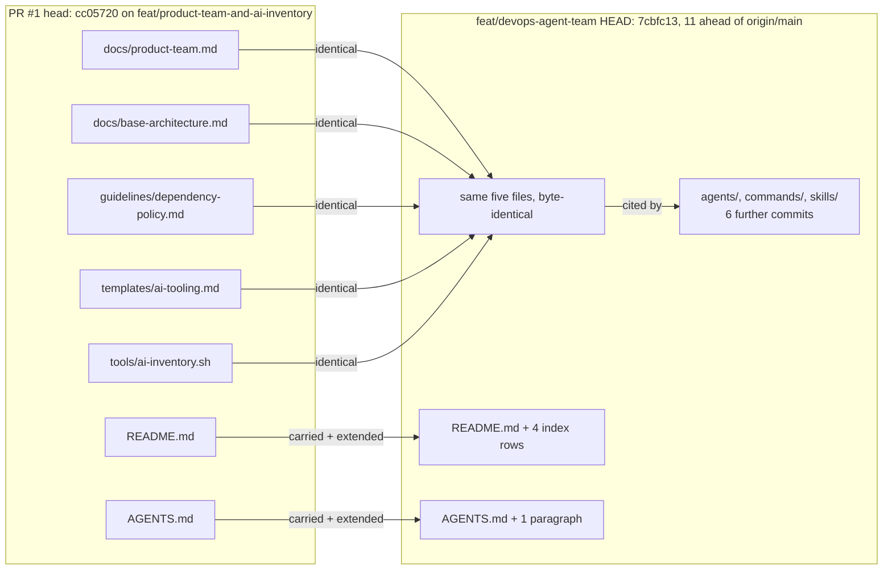

# 05: Review of open pull request #1 against the workspace repository

**Agent:** `cloud-solutions-architect`
**Prompt:** `docs/prompts/05-review-open-pr.md`
**Ticket:** UNTRACKED
**Date:** 2026-11-21

## Recommendation

**Close pull request #1 as absorbed.** All five files it adds are byte-identical
on `feat/devops-agent-team`, and the two files it edits were carried forward and
extended there. Nothing is lost by closing it, and keeping it open maintains a
second copy of the same content on a branch nobody is building on.

Closing is correct only if three content findings move with it, because the pull
request is currently the only open review surface for them. All three live in
files that `feat/devops-agent-team` also carries:

| Finding | File | Must be fixed before |
|---|---|---|
| The unsatisfiable-peer reject signal is false | `guidelines/dependency-policy.md:76` | `feat/devops-agent-team` merges |
| "Zero runtime vulnerabilities" no longer holds in the base it cites | `docs/base-architecture.md:24` | `feat/devops-agent-team` merges |
| "Seven of the roles exist and have done real work" contradicts the base | `docs/product-team.md:7-9` | `feat/devops-agent-team` merges |

The merge or close action belongs to the operator. This role decides technical
shape, not whether a change ships; that boundary is in
`../ai-software-engineering/agents/README.md:42-50`. Read-only GitHub access was
the constraint on this run, so nothing was merged, closed, or commented.

## Refs measured

Every repository read, measured 2026-11-21 before any file was opened.

| Repository | Branch | HEAD | Behind `origin/main` | Ahead | Dirty |
|---|---|---|---|---|---|
| `hire-service` | `main` | `bd42a3d` | 0 | 0 | **2** |
| `ai-software-engineering` | `feat/devops-agent-team` | `7cbfc13` | 0 | 11 | 4 (untracked) |

No third repository was opened. `github.com/arqui-dev/sweai-base-apps` is the
remote of `hire-service` itself (`git remote -v`), so the links in the pull
request point at the same code this review read, not at a separate repository.

## The framework lens

**No cloud well-architected framework applies to this target.** The stack under
review is Vercel plus four managed SaaS products (Supabase, Stripe, Sanity,
Resend). There is no AWS, Azure, Google Cloud, or Kubernetes layer, so applying
any of those four pillar sets would be importing pillar names from a cloud this
system does not run on.

The applicable lens is the **CNCF Cloud Native Definition v1.1**, approved by
the CNCF TOC and Governing Board on 2024-02-26, fetched in this session from
`github.com/cncf/toc/blob/main/DEFINITION.md`. It names five characteristics of
the systems it describes: **secure, resilient, manageable, sustainable,
observable**. Each finding below is attributed to exactly one of them.

The definition's named technologies (containers, service meshes,
multi-tenancy, microservices, immutable infrastructure, serverless, declarative
APIs) are explicitly non-exhaustive, so the serverless-plus-SaaS shape here is
in scope for the definition even though the container stack is not present.

## Premises in the brief that the code contradicts

Four. Reported rather than carried forward, and no corrected figure was
substituted silently.

**1. The four-role team does not supersede `docs/product-team.md`.** The prompt
asks which claims are "now stale, given the four-role team supersedes parts of
`docs/product-team.md`". The code shows the opposite relationship.
`agents/README.md:7-10` names `docs/product-team.md` as the source of the
organizing rule the four-role team applies, and `agents/README.md:37-54`
documents one deliberate divergence from it by name. A superseded document does
not get cited as the parent of the thing that supersedes it. One row in
`docs/product-team.md` is now diverged from, not stale: the "Product manager, not
created" row at `docs/product-team.md:104` is exactly what
`agents/README.md:37-54` argues against for an engagement. The divergence is
already written down on the devops branch, so no edit to
`docs/product-team.md` is needed for it.

**2. `hire-service` has 2 dirty files, not 0.** The Stage 0 record states 0.
Measured: `CLAUDE.md` is modified with 74 added lines, and `docs/prompts/` is
untracked. This matters for every citation in this review that reads
`hire-service/CLAUDE.md`: the sections "Environments and promotion order",
"Ticket tracker and conventions", "Verification commands", "Documentation
locations" and "Agent team" exist only in the working tree. `git show
HEAD:CLAUDE.md` ends at "MCP servers in use". Those five sections are uncommitted
and a reviewer reading `bd42a3d` will not find them.

**3. `vite-plus` has 158 published versions today, not 157.** Measured with
`npm view vite-plus versions --json`. The count of versions satisfying
`^0.1.15 || ^0.2.0` is still 20, and `npm view storybook@10.6.5
peerDependenciesMeta --json` still returns `vite-plus: { optional: true }`. The
conclusion the brief drew is confirmed; the figure moved by one publish in one
day, which is itself the argument for the policy's own rule at
`guidelines/dependency-policy.md:91-92`.

**4. The five commits carry no Claude attribution.** The prompt and the Stage 0
record both state the five commits were "written by Claude". `gh pr view 1`
reports the author as `andrevst` and all five commits authored and committed by
`andrevst <andreveigatonelli@gmail.com>` with empty message bodies. No
`Co-Authored-By` trailer, no mention in the pull request body.
`guidelines/writing-style.md:14` requires saying "Claude" for work Claude did, so
if the premise is true the attribution is missing from the commits and the
description.

## Findings in the seven files

Coverage: **7 of 7 changed files read in full.** The five added files were read
from `feat/devops-agent-team` (byte-identical to `cc05720` for all five,
confirmed by `git diff cc05720 HEAD`). `README.md` and `AGENTS.md` were read in
full at both `cc05720` and `7cbfc13`.

| # | Finding | Location | CNCF characteristic | Evidence |
|---|---|---|---|---|
| 1 | The unsatisfiable-peer reject signal is false. No published `vite-plus` version is missing from the range, the peer is optional, and the install resolves without an override | `guidelines/dependency-policy.md:76` | Secure | 20 of 158 versions satisfy `^0.1.15 \|\| ^0.2.0`; `peerDependenciesMeta` returns `optional: true`; `storybook@10.6.5` is installed in `hire-service` |
| 2 | "Zero runtime vulnerabilities, gated in CI" is no longer true of the base it cites | `docs/base-architecture.md:24` | Secure | `npm run audit:runtime` in `hire-service` at `bd42a3d` exits 1: one moderate advisory, `next` range `16.0.0 - 16.4.4`, installed `16.4.3`, fix at `16.4.6` |
| 3 | "Seven of the roles below exist and have done real work" contradicts the base's own inventory | `docs/product-team.md:7-9` | Manageable | `hire-service/docs/ai-tooling.md:12-15`: "8 agent definitions owned by this repository, none of them yet executed." `hire-service/CLAUDE.md` (working tree) repeats it: "none has been executed through it" |
| 4 | Three of the seven roles claimed to exist have no agent definition anywhere in the base | `docs/product-team.md:29,33,34` | Manageable | `ls hire-service/.claude/agents/` returns eight files. `security-reviewer`, `dependency-reviewer` and `release-checker` match by name. Product architect, interface curator and verification engineer have no file |
| 5 | The model-tier table both new documents route through carries one invalid model id and one superseded top tier | `AGENTS.md:15,17` | Manageable | `claude-haiku-4-5-20251001` is not a valid id; the current id is `claude-haiku-4-5` with no date suffix. `claude-opus-4-8` is real but no longer the top tier. Source: bundled `claude-api` skill model table, cached 2026-06-24. Cited by `docs/product-team.md:39-40` and `agents/README.md:21` |
| 6 | The script this PR contributes has already forked from the copy the base runs | `tools/ai-inventory.sh` vs `hire-service/scripts/ai-inventory.sh` | Manageable | `diff` shows four divergent hunks. The workspace copy guards a missing `.claude/agents` and resolves the workspace root from `BASH_SOURCE`; the `hire-service` copy hardcodes `W=../ai-software-engineering` and crashes on a missing directory |
| 7 | Two of the five commit subjects use a type outside the allowed list | `5de409b` (`guidelines:`), `f800767` (`templates+tools:`) | Manageable | `guidelines/writing-style.md:38` allows `feat`, `fix`, `docs`, `chore`, `refactor`, `test`, `perf` only |

Measured and inferred, labeled: findings 1, 2, 4, 6 and 7 are measured from
command output shown above. Finding 3 is measured from two documents that state
it in words. Finding 5 is measured against the bundled skill's model table,
which is itself cached as of 2026-06-24, so the `claude-haiku-4-5-20251001` id is
measured-invalid and the "superseded top tier" half is inferred from that same
cached table rather than from a live Models API call.

### What is correct and should not be re-raised

Verified against `hire-service` at `bd42a3d`, so a later reviewer does not spend
the time again.

| Claim | Location | Measured |
|---|---|---|
| Twelve production dependencies | `docs/base-architecture.md:24` | 12 keys in `dependencies` |
| Eight ADRs, arc42 record | `docs/base-architecture.md:8`, `docs/product-team.md:7` | `docs/adr/` holds `ADR-001` to `ADR-008`; `docs/arc42/` holds chapters `01-` to `12-` |
| Five selectable themes | `docs/base-architecture.md:7` | `brutalist`, `editorial`, `minimalist`, `modern`, `terminal` in `src/app/themes.css` |
| Two lead lists | `docs/base-architecture.md:7` | `LEAD_LISTS = ["waitlist", "early-access"]` at `src/features/leads/leads.schema.ts:7` |
| 21 advisories, 3 high, from the embedded editor wrapper | `docs/base-architecture.md:39` | `docs/adr/ADR-006-hosted-sanity-studio.md:15-16` and `:68` |
| `node:crypto` covers HMAC and constant-time compare | `guidelines/dependency-policy.md:40-41` | `createHmac`, `timingSafeEqual` at `src/features/newsletter/unsubscribe.ts:1` |
| The Popover API replaces a menu component | `guidelines/dependency-policy.md:43-44` | `src/components/site-menu.tsx`, `src/app/globals.css` |
| `npm ls --omit=dev --all` over-reports | `guidelines/dependency-policy.md:80-81` | `hire-service/docs/dependencies.md` records 237 from that command against 78 correct |
| `tools/ai-inventory.sh` is `bash -n` clean and degrades without `.claude/agents` | pull request body | `bash -n` clean; run from an empty directory it exits 0 and prints `(no .claude/agents in ...)` |

## Does `docs/base-architecture.md` still describe this base accurately?

**What the code does, measured 2026-11-21 at `bd42a3d`.** Twelve production
dependencies. Next.js `16.4.3`, pinned exactly. `npm run audit:runtime` exits 1
on one moderate `next` advisory whose fix is `16.4.6`, outside the pinned range.
Eight ADRs, twelve arc42 chapters, five themes, two lead lists, Postgres row
level security as the authorization layer, Stripe hosted Checkout, a
vendor-hosted Sanity Studio, one Vercel project per deployable.

**What the document says.** Every structural claim in it holds. One measurement
claim no longer does: `docs/base-architecture.md:24` states "Zero runtime
vulnerabilities, gated in CI", and the gate is red today. Decision 7 at
`docs/base-architecture.md:40` states the tolerance is non-negotiable and the
reversal condition is "Never", which makes the red gate a defect in the base
rather than an acceptable state of it.

The document is therefore accurate as a description of the architecture and
stale as a description of its current measurements. The distinction matters
because the fix differs: the architecture needs no edit, and the number needs
either a repair in `hire-service` or a rewrite of the sentence into a gate
statement that does not also assert a result.

The same staleness sits in `hire-service/docs/dependencies.md:7`, which claims
"0 known vulnerabilities". That file is outside this pull request's diff and is
listed here as an adjacent finding, not as a change this review proposes.

## The two tables

`hire-service/CLAUDE.md` carries neither an "already fixed, do not re-report"
table nor a "known and accepted" table, and names no file that holds them. The
only copies in the repository are scoped to one agent:
`.claude/agents/security-reviewer.md:53` and `:63`. Three of the four entries
under "known and accepted" there are platform-wide, not security-specific,
which is why they belong one level up.

Nothing in this review re-reports an entry from either of those tables. The
`npm audit` entry at `.claude/agents/security-reviewer.md:70` states findings
exist in build-time tooling only. Finding 2 above is the reopening condition for
that entry being met: the advisory is now in the runtime tree, not the build
tree, and the evidence is the `audit:runtime` exit code.

Proposed first version of both tables at the repository level, below, as a diff.

## Decision: what to do with pull request #1

### Decision drivers

1. All five added files are already on `feat/devops-agent-team`, byte-identical.
2. `feat/devops-agent-team` is 11 commits ahead of `origin/main` and holds six
   further commits that depend on the five (`agents/README.md:7-10` links
   `docs/product-team.md`; `README.md:52-55` and `AGENTS.md:27-29` link both).
3. Three content findings are open against files both branches carry.
4. The operator is working on `feat/devops-agent-team`, not on
   `feat/product-team-and-ai-inventory`.

### Options

| Criterion | A: close as absorbed | B: rebase onto `main` and keep reviewing | C: keep open unchanged |
|---|---|---|---|
| Lines of content lost | 0 | 0 | 0 |
| Branches carrying the same 516 added lines afterwards | 1 | 2 | 2 |
| Commit-subject violations to relitigate (finding 7) | 0, the commits stay unmerged | 2 | 2 |
| Where the three content fixes land | `feat/devops-agent-team`, once | Both branches, or they diverge | Nowhere, no one is building on that branch |
| Review surface for the six dependent commits | The devops branch, which is where they are | Split across two pull requests | Split, and one is stale |

### Recommendation

Option A. The deciding criterion is the last row: the five commits cannot be
reviewed in isolation from the six that build on them, because
`agents/README.md` derives its divergence argument from `docs/product-team.md`
and `README.md` and `AGENTS.md` index both sets. A review of the five alone
cannot tell whether the divergence is coherent, which is the only question in
the content worth a reviewer's attention.

**Reversal condition.** Option B becomes correct if `feat/devops-agent-team`
stops being the branch headed for `main`: if the six later commits are abandoned
or deferred, the five earlier ones are an independently valuable contribution
and need their own pull request. Option C never becomes correct; an open pull
request whose head commit is also an ancestor of the branch under active
development is a duplicate review surface in every state.

**Cost.** No dollar cost; nothing is deployed and nothing is provisioned.
The measurable cost of not closing is reviewing 516 added lines twice, across
two pull requests, with the three findings above needing a fix in each.

**Assumptions that can be checked.**

1. `feat/devops-agent-team` is the branch intended for `main`. Check: ask the
   operator, or observe which branch receives the next commit.
2. `cc05720` is an ancestor of `7cbfc13`. Checked: `git branch --contains` lists
   `feat/devops-agent-team` for all five commits.
3. The five files are identical on both branches. Checked: `git diff cc05720
   HEAD` over the five paths reports no change; only `README.md` and `AGENTS.md`
   differ, and both differ by additions made on the devops branch.

**Rollout path, including the halfway state.** Fix the three content findings on
`feat/devops-agent-team` first, then close pull request #1 with a comment naming
the commit that absorbed it. Halfway through, the pull request is open and its
content is fixed on another branch, which is the current state plus three
corrections; nothing is broken by stopping there. Closing first and fixing
second is the order to avoid, because it leaves the known-false claim at
`guidelines/dependency-policy.md:76` with no open review surface.

### Where the content lives now



One question answered: nothing in the pull request exists only in the pull
request.

## Proposed edits

Not applied, not committed. Four diffs against `feat/devops-agent-team` at
`7cbfc13`, plus one against `hire-service` at `bd42a3d`.

### 1. Replace the false reject signal

The signal to keep is the one the crash actually demonstrates: a package manager
that aborts instead of reporting an unmet peer. The cause of that crash is
unexplained, so the row says what was observed and does not name a mechanism.

```diff
--- a/guidelines/dependency-policy.md
+++ b/guidelines/dependency-policy.md
@@ -73,7 +73,7 @@
 | A git or URL dependency on a branch rather than a commit SHA | The target can change after review |
 | A floating range: `latest`, `*`, or a bare major | Tooling writes these. One framework's installer added two `"latest"` entries that had to be pinned by hand |
 | A transitive count out of proportion to the job | |
-| An unsatisfiable peer range | One widely used package declared a peer whose range no published version satisfied, which crashed the package manager instead of reporting an unmet peer |
+| An install that crashes the package manager rather than failing | One Storybook install aborted `npm` 10.9.3 repeatedly while resolving an optional peer. The cause is unexplained. A resolver that aborts instead of reporting is a signal regardless of why, because the tree it would have produced was never inspected |
```

A reject signal whose worked example is false gets the whole table ignored,
which is the same failure mode the "already fixed" table exists to prevent.

### 2. Separate the gate from the result

```diff
--- a/docs/base-architecture.md
+++ b/docs/base-architecture.md
@@ -22,7 +22,8 @@
 | Validation | One schema library at every trust boundary | Hand-written type guards |

-Twelve production dependencies. Zero runtime vulnerabilities, gated in CI.
+Twelve production dependencies. The runtime tree is gated in CI at
+`--audit-level=info`, so any advisory at all fails the build.
```

The gate is the architectural property and it still holds. Whether the gate is
green on a given day is a measurement, and a measurement written into a
reference document goes stale without anyone noticing, which is what happened.

### 3. State what the roles are, not what they have done

```diff
--- a/docs/product-team.md
+++ b/docs/product-team.md
@@ -4,10 +4,11 @@
 that keeps the arrangement from becoming a committee.

 Validated on a working application: a Next.js base wired to Supabase, Stripe,
-Sanity and Resend, documented with arc42 and eight ADRs. Seven of the roles
-below exist and have done real work. The ones marked as proposed have not, and
-say so.
+Sanity and Resend, documented with arc42 and eight ADRs. Seven of the roles
+below exist as agent definitions in that project. None has yet been executed
+through a session that loaded them, so treat the roster as a design the code
+supports rather than a record of work done. The ones marked as proposed have no
+definition at all, and say so.
```

Source: `hire-service/docs/ai-tooling.md:12-15`.

### 4. Correct the model table both documents route through

```diff
--- a/AGENTS.md
+++ b/AGENTS.md
@@ -12,10 +12,10 @@

 | Task type | Model |
 |-----------|-------|
-| Long-form reasoning, ADR writing, architecture synthesis | `claude-opus-4-8` |
+| Long-form reasoning, ADR writing, architecture synthesis | `claude-opus-5` |
 | Code analysis, YAML/HCL/JSON generation, cross-file analysis | `claude-sonnet-4-6` |
-| Narrow structured output (access entries, diffs, short reports) | `claude-haiku-4-5-20251001` |
+| Narrow structured output (access entries, diffs, short reports) | `claude-haiku-4-5` |
 | Parallel sub-agents (dependency audit, component analysis, ADR generation) | `claude-sonnet-4-6` |
```

`claude-haiku-4-5-20251001` is not a valid id; ids in this family carry no date
suffix. Two documents resolve their tiers through this table
(`docs/product-team.md:39-40`, `agents/README.md:21`), so an invalid id here
propagates into both.

### 5. The two tables, at the repository level

Proposed for `hire-service/CLAUDE.md`. The entries are lifted from
`.claude/agents/security-reviewer.md:53-71`, promoted out of the
security-specific scope where three of the four do not belong, with a reopening
condition added to each. The silent-catch row comes from the forbidden-patterns
list in `CLAUDE.md`, and the agents row from `docs/ai-tooling.md:12-15`.

```diff
--- a/CLAUDE.md
+++ b/CLAUDE.md
@@
+## Already fixed, do not re-report
+
+Mention one of these only if it regressed, and show the regression.
+
+| Was | Fixed by |
+|-----|----------|
+| `javascript:` href from the CMS | `safeHref`, 7 hostile schemes tested |
+| HTML injection into outbound email | `escapeHtml` |
+| Security events unlogged | `logger.warn` on all three paths |
+| `notFound()` returning 200 | `blog/loading.tsx` removed from the subtree |
+| Empty secret becoming a public placeholder | random bytes in `src/env.ts` |
+| Four silent catch blocks hiding a misconfigured Sanity project | every catch returns `err(...)`, logs, or rethrows |
+
+## Known and accepted
+
+State these as accepted, not as findings, unless the diff changes them or the
+reopening condition is met.
+
+| Accepted | Reopens when |
+|----------|--------------|
+| CSP is `Content-Security-Policy-Report-Only`, because Next injects inline bootstrap scripts | Next stops injecting them, or a nonce-based policy passes the story suite |
+| Rate limiting is per serverless instance | A second instance serves the same list, or an abuse incident is recorded |
+| `npm audit` findings exist in build-time tooling only | An advisory appears in the `--omit=dev` tree. **Met 2026-11-21**: `npm run audit:runtime` exits 1 on one moderate `next` advisory |
+| Previews share the development Supabase project | A live credential is set on either environment |
+| The eight agents in `.claude/agents/` are a design, not a proven capability | One of them runs through a session that loaded it, and its output is recorded in `docs/runs/` |
```

The third row is written as already met, because it is. Marking the condition
met in the table is what stops the next reviewer treating the red gate as
accepted.

### 6. Not proposed: deduplicating the inventory script

Finding 6 is a real duplication, and the fix needs a decision this review is not
the right place to make. Two options, for whoever takes it: symlink
`hire-service/scripts/ai-inventory.sh` to the workspace copy, which keeps one
implementation and breaks `npm run ai:inventory` for anyone who clones
`hire-service` without the workspace beside it; or delete the local copy and
point `npm run ai:inventory` at `../ai-software-engineering/tools/ai-inventory.sh`,
which makes the dependency explicit and fails loudly instead of silently. The
criterion that settles it is whether `hire-service` must run standalone. The
answer is in `hire-service/CLAUDE.md`, which opens by declaring the workspace a
sibling requirement, so the second option is likely correct. Left open because
the first line of that file is a convention statement, not a tested constraint.

## What this review could not reach

- **The cause of the `npm` crash.** The crash was observed; no mechanism was
  established. Proposed edit 1 is written so the policy does not depend on one.
- **Whether `feat/devops-agent-team` is the branch headed for `main`.** Inferred
  from it being 11 commits ahead with the most recent work on it. Not confirmed
  with the operator.
- **A live model-availability check.** Finding 5 rests on the bundled
  `claude-api` skill's table, cached 2026-06-24. A `GET /v1/models` call would
  confirm it; no credential was used on this run.
- **Pull request checks.** `gh pr view 1` reports no status checks on the branch,
  so there is no CI signal to re-run or trust.
- **Whether the 74 uncommitted lines in `hire-service/CLAUDE.md` are intended.**
  They are read in this review and cited as working-tree content, not as
  `bd42a3d`.
- **The six later commits on `feat/devops-agent-team`.** Out of scope for this
  prompt, which named the seven files in pull request #1. `agents/README.md` was
  read in full because the brief's supersession premise could not be tested
  without it.

## Approval

This role does not approve its own proposals. The six diffs above need the
`sre` on fresh context before anything is applied, per
`../ai-software-engineering/agents/README.md:181-185`.

## Log

- **2026-11-21** Reviewed. 7 of 7 changed files read in full. Recommendation:
  close as absorbed, after the three content findings land on
  `feat/devops-agent-team`.
