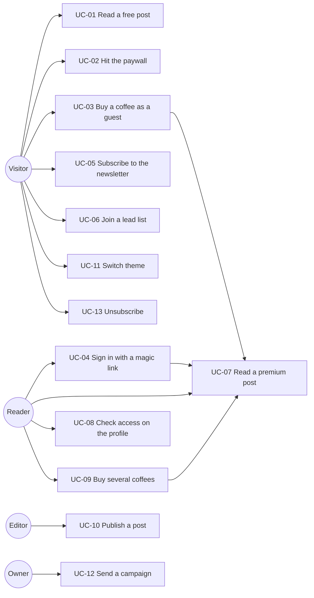

# Use cases

Thirteen use cases. Each names its actor, its trigger, the code that implements
it, and the one failure worth designing for. "Checked by" names the test or the
mechanism that keeps it honest.

## UC-01: Read a free post

| | |
|---|---|
| Actor | Visitor, signed in or not |
| Trigger | `GET /blog/[slug]` on a post with `isPremium` false |
| Implementation | `posts.queries.getPost`, `components/post-body.tsx` |
| Outcome | Full Portable Text rendered server-side |
| Designed failure | Sanity unreachable. `/blog` catches and shows a message naming the env var to check, instead of a stack trace |
| Checked by | `isLocked({ isPremium: false }, false) === false` |

## UC-02: Hit the paywall

| | |
|---|---|
| Actor | Visitor without an entitlement |
| Trigger | `GET /blog/[slug]` on a premium post |
| Implementation | `hasPremium()`, GROQ `select(... => body, null)`, `components/paywall.tsx` |
| Outcome | Title, excerpt and a paywall. The body is not in the response |
| Designed failure | A future component passes the post to a client component. Impossible to leak, because the body was never resolved ([ADR-005](adr/ADR-005-paywall-enforced-in-the-groq-query.md)) |
| Checked by | `posts.gate.test.ts`, plus `assertNoLeak` at runtime |

## UC-03: Buy a coffee as a guest

| | |
|---|---|
| Actor | Visitor, not signed in |
| Trigger | Coffee button on `/coffee`, the landing page, or a paywall, with an email for the receipt |
| Implementation | `POST /api/checkout`, `checkout.service`, Stripe Checkout, `POST /api/stripe/webhook`, `grantPremium` |
| Outcome | One `entitlements` row keyed to the receipt email |
| Designed failure | Stripe replays the event. `unique (stripe_event_id)` plus `ignoreDuplicates` makes the second delivery a no-op |
| Checked by | `payments.schema.test.ts` for the input, the unique constraint for the replay |

## UC-04: Sign in with a magic link

| | |
|---|---|
| Actor | Reader with an email address |
| Trigger | `/login` form submit |
| Implementation | `signInWithOtp`, `GET /auth/callback`, `src/proxy.ts` |
| Outcome | Session cookie set, redirect to the `next` path |
| Designed failure | A crafted `next` pointing off site. The callback accepts a value only if it starts with `/` |
| Checked by | Manual: `curl -i '/auth/callback?code=x&next=https://evil.test'` redirects to `/login?error=...` |

## UC-05: Subscribe to the newsletter

| | |
|---|---|
| Actor | Visitor |
| Trigger | `EmailCapture` on the landing page, `/subscribe`, or `/profile` |
| Implementation | `POST /api/newsletter`, `newsletter.service.subscribe` |
| Outcome | Upserted row, welcome mail on first subscribe only |
| Designed failure | Resend down. The address is already stored, so the send is caught, logged, and the visitor still sees success |
| Checked by | `curl` with an invalid address returns 422 with field errors |

## UC-06: Join a lead list

| | |
|---|---|
| Actor | Visitor, typically Priya |
| Trigger | `/waitlist` or `/early-access` form submit |
| Implementation | `POST /api/leads`, `leads.service.captureLead` |
| Outcome | One row in `leads` with the list name, plus a confirmation mail carrying the position |
| Designed failure | Same person submits twice. `unique (email, list)` makes it an update |
| Checked by | `curl` with `list: "bogus"` returns 422 |

## UC-07: Read a premium post

| | |
|---|---|
| Actor | Reader with an entitlement |
| Trigger | `GET /blog/[slug]` on a premium post while signed in |
| Implementation | `hasPremium()` under RLS, then `getPost(slug, true)` |
| Outcome | Full body rendered server-side |
| Designed failure | Another user's entitlement is somehow queried. The RLS policy restricts rows to `auth.uid()` or `auth.email()`, so the query can only ever see their own |
| Checked by | The policy in `supabase/schema.sql` |

## UC-08: Check access on the profile

| | |
|---|---|
| Actor | Signed-in reader |
| Trigger | `GET /profile` |
| Implementation | `createSupabaseServerClient`, `hasPremium`, subscriber lookup |
| Outcome | Email, premium state and newsletter state, with the missing action offered inline |
| Designed failure | Anonymous access. Middleware redirects, and the page checks again and redirects itself |
| Checked by | `curl -i /profile` returns 307 to `/login?next=%2Fprofile` |

## UC-09: Buy several coffees

| | |
|---|---|
| Actor | Visitor who wants to tip |
| Trigger | `/cart`, quantity stepper, pay |
| Implementation | `cart-client.tsx`, `POST /api/checkout` with `quantity` |
| Outcome | One Checkout session for N coffees, same single premium grant |
| Designed failure | A tampered request carrying its own price. The schema strips unknown keys and the service builds `unit_amount` from `src/env.ts` |
| Checked by | `payments.schema.test.ts`, including the quantity cap and the stripped-price case |

## UC-10: Publish a post

| | |
|---|---|
| Actor | Editor |
| Trigger | Publish in the Sanity-hosted Studio |
| Implementation | `sanity/schema/post.ts` deployed with `npx sanity deploy`, 60 second revalidate on the list and detail queries |
| Outcome | Post appears within a minute, with no deploy of this application |
| Designed failure | Publishing a premium post with no excerpt, leaving an empty teaser. `excerpt` is a required field with a 300 character cap |
| Checked by | Sanity schema validation |

## UC-11: Switch theme

| | |
|---|---|
| Actor | Any visitor |
| Trigger | The select in the header, or "Use this design" on `/themes` |
| Implementation | `applyTheme` sets `data-theme` and the cookie; the root layout reads the cookie; `/themes` previews all five by scoping the attribute to a wrapper |
| Outcome | All five presets apply with no reload and no re-render |
| Designed failure | A tampered cookie value. `isThemeId` rejects it and falls back to `minimalist`, so the page is never unstyled |
| Checked by | `curl -b "theme=bogus" /` renders `data-theme="minimalist"` |

## UC-12: Send a campaign

| | |
|---|---|
| Actor | Owner |
| Trigger | `POST /api/newsletter/send` with a bearer token |
| Implementation | `newsletter.service.sendCampaign`, Resend `batch.send` in groups of 100 |
| Outcome | `{ sent, failed }` counts |
| Designed failure | A guessed token. The comparison is `timingSafeEqual` on equal-length buffers, so it leaks no timing signal; a wrong token returns 401 before the body is parsed |
| Checked by | `curl` with no authorization header returns 401 |

## UC-13: Unsubscribe

| | |
|---|---|
| Actor | Subscriber, from an inbox or from `/profile` |
| Trigger | The signed link in any mail footer, the mail client's own unsubscribe button, or the Leave link on the profile |
| Implementation | `features/newsletter/unsubscribe.ts`, `POST /api/newsletter/unsubscribe`, `/unsubscribe` page |
| Outcome | `unsubscribed_at` set, row kept, campaign query stops selecting the address |
| Designed failure | A link scanner prefetching the URL, or someone unsubscribing a guessed address. The endpoint is POST only, and the token is an HMAC over the address compared with `timingSafeEqual` |
| Checked by | `unsubscribe.test.ts`, five cases including a token minted for a different address |
